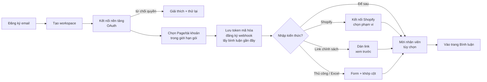
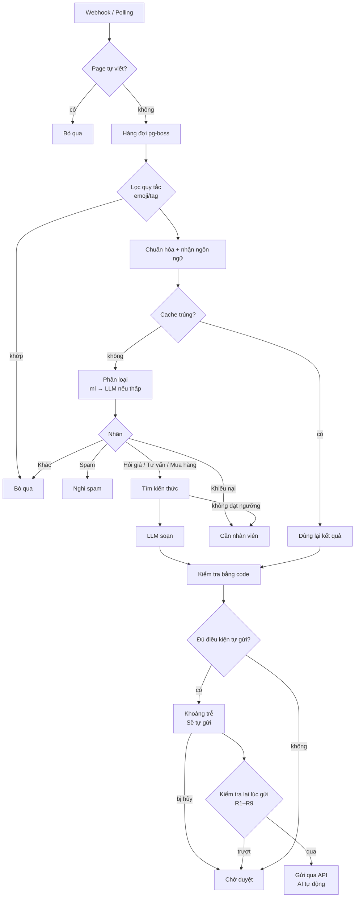
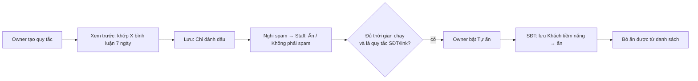
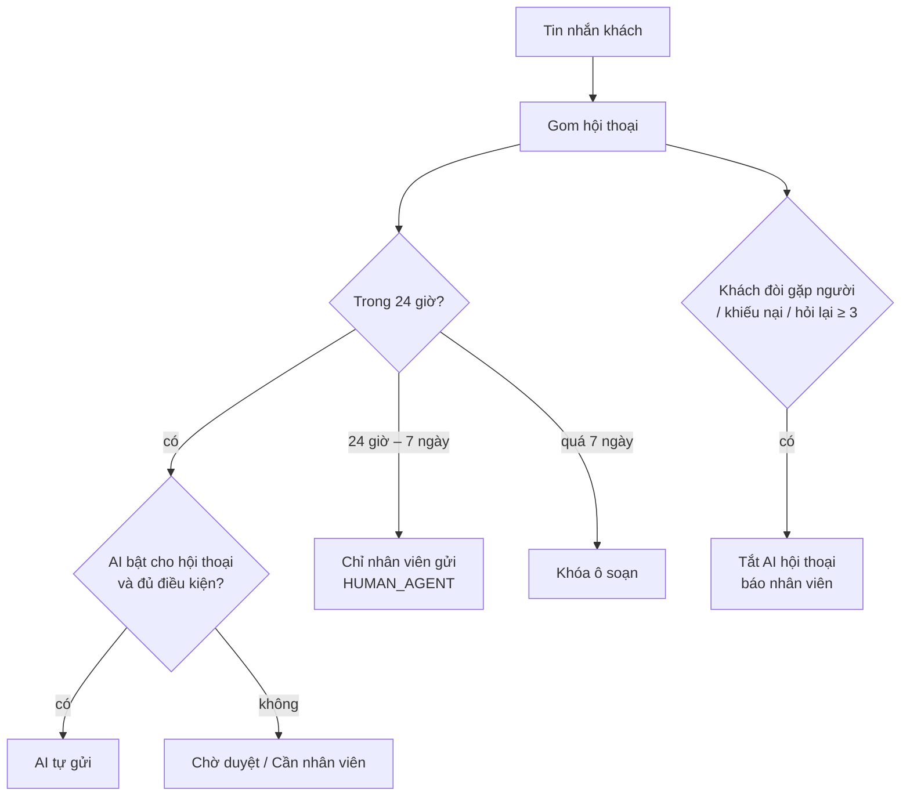
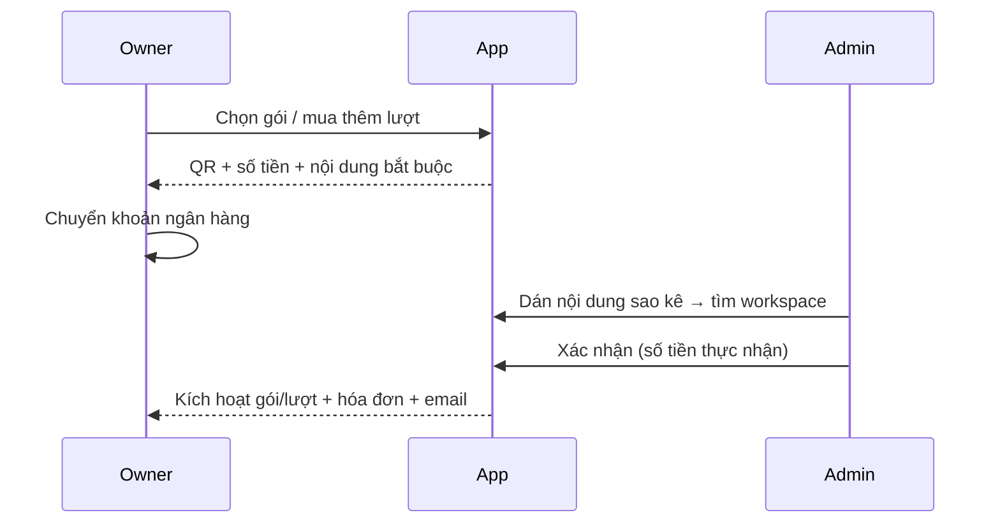
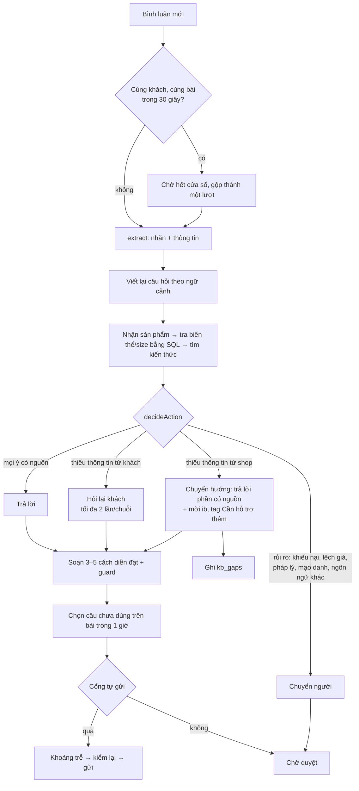

# 07 — Luồng người dùng

> Phiên bản 0.4 · 02/11/2026 (thêm UF-2b, UF-11 cho FR-141–165; đồng bộ với bổ sung kiến trúc) · Sơ đồ Mermaid xem được trên GitHub, VS Code, Notion. Nguồn: Workflow 1–7 trong [tài liệu quy trình](https://claude.ai/artifact/L3eU24A9Chw6rHbwAjN8dP).

## UF-1 Onboarding (Owner)

Mục tiêu: < 30 phút đến gợi ý đầu tiên. Chưa có kiến thức → AI chỉ phân loại.

## UF-2 Xử lý bình luận (hệ thống)

## UF-3 Duyệt và gửi (Staff)

1. Mở trang Bình luận → tab Chờ duyệt (cũ nhất trước; Mua hàng/Khiếu nại lên đầu).
2. Mở bình luận → khóa mềm cho người khác.
3. Xem ngữ cảnh bài + sản phẩm gắn bài, nhãn + độ tin cậy, gợi ý + chip nguồn.
4. Chọn: **Gửi** · **Sửa rồi gửi** · **Đổi nhãn** · **Ẩn** · **Bỏ qua** · **Nhắn riêng** (GĐ5).
5. Gửi → kiểm tra lại lúc gửi (`09_System_Architecture.md` §6.1; giá đổi → hỏi xác nhận) → API → Đã trả lời (lưu `external_reply_id`) hoặc Gửi lỗi (lý do + Thử lại).
6. Ghi nhật ký → tự mở bình luận kế tiếp.

## UF-4 Spam và tự ẩn

## UF-5 AI tự trả lời (Owner bật)

1. Owner vào Tự động hóa → tab Bình luận → đặt kênh × nhãn ở **Chạy thử**.
2. Hệ thống ghi "sẽ gửi câu này"; nhân viên vẫn duyệt tay.
3. Tab Chạy thử & xem lại: bảng hiệu chuẩn, ngưỡng đề xuất kèm lý do.
4. Đủ 50 mẫu, tỷ lệ sửa ≤ 10% → nút **Chuyển sang Tự động** sáng → Owner xác nhận.
5. Câu đủ điều kiện → khoảng trễ (hủy được) → gửi → tab AI đã tự gửi; Staff có thể **Đánh dấu sai**.
6. Bất thường → tự tạm dừng + banner; bất kỳ ai bấm **Dừng khẩn cấp** → tắt toàn workspace.
7. Owner xuất bản thay đổi Sản phẩm/Chính sách → nhãn liên quan về Chạy thử.

## UF-6 Tin nhắn (GĐ5)

## UF-7 Gắn sản phẩm cho bài viết

1. Trang Bài viết → lọc **Chưa gắn**, sắp theo số bình luận chờ.
2. Mở bài → tìm sản phẩm → gắn (đánh dấu sản phẩm chính) hoặc xác nhận gợi ý AI.
3. Thêm ghi chú có ngày hiệu lực (tùy chọn); ghi đè chế độ tự động cho bài (tùy chọn).
4. Từ giờ AI dùng: ghi chú bài → sản phẩm gắn → kiến thức chung.

## UF-8 Kiến thức: xuất bản

Sửa ở bản nháp → **Chạy kiểm thử** (bộ câu kiểm thử) → xem thay đổi → **Xuất bản** → `kb_version` mới; nếu đổi Sản phẩm/Chính sách → hộp xác nhận "các nhãn Tự động liên quan về Chạy thử".

## UF-9 Thanh toán

## UF-10 Yêu cầu xóa dữ liệu

Người dùng Facebook gửi yêu cầu → Meta gọi endpoint với signed request → hệ thống xác minh chữ ký, tạo yêu cầu, trả `{url, confirmation_code}` → worker xóa dữ liệu liên quan → trang tra cứu công khai hiển thị trạng thái (Đã nhận / Đang xử lý / Đã xóa / Từ chối + lý do).

## UF-2b Thang xử lý khi AI không chắc (bổ sung 02/11 — chi tiết bước "Tìm kiến thức → LLM soạn" của UF-2)

## UF-11 Bổ sung kiến thức từ câu hỏi AI chưa trả lời được (Owner, bổ sung 02/11)

1. Owner mở Cơ sở kiến thức → **Câu hỏi AI chưa trả lời được** (gom theo chủ đề: phí ship, size, đơn hàng, chính sách…, kèm số lần và câu ví dụ đã che PII).
2. Bấm **Bổ sung** → mở đúng mục (Chính sách giao hàng, Bảng size, FAQ, thẻ sản phẩm) với câu hỏi mẫu điền sẵn.
3. Lưu → Kiểm thử → Xuất bản → các mục `kb_gaps` liên quan chuyển `resolved`; thanh Độ sẵn sàng cập nhật.
4. Hoặc bấm **Bỏ qua** nếu shop không muốn AI trả lời chủ đề đó (giữ chuyển hướng ib).
