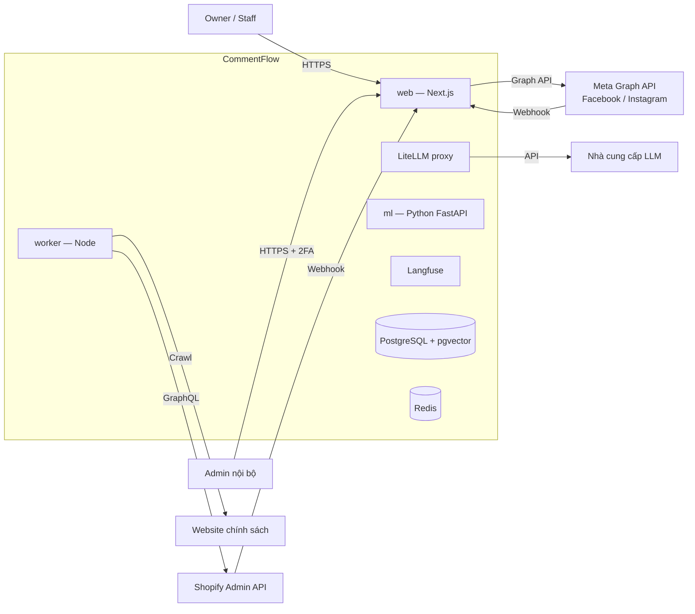
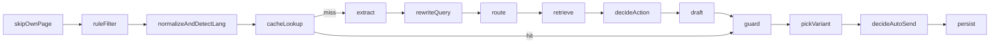
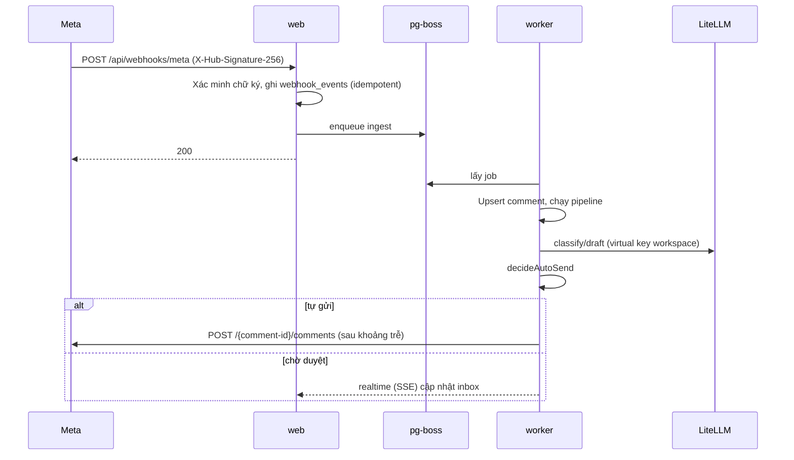

# 09 — Kiến trúc tổng thể hệ thống

> Phiên bản 0.7 · 02/11/2026 (lõi pipeline FR-161–165: extract, độ tin cậy tính bằng code, đa dạng câu, chống cài lệnh qua nguồn, bộ đánh giá; thang xử lý khi không chắc + tình huống thực tế FR-147–160; chất lượng trả lời thực tế FR-141–146; bổ sung tìm kiếm chính xác FR-127–135, định tuyến/viết lại câu hỏi/prompt caching/halfvec/trích nguồn FR-136–140; trước đó: saas-core, feature flag, đối soát Shopify, bảo vệ Meta App, kiểm tra lại trước khi gửi) · Dựa trên source Next.js/TypeScript hiện có + các thành phần bổ sung đã thống nhất. Những chỗ ghi **(cần đối chiếu source)** phải kiểm lại với code thực tế trước khi làm.

## 1. Bối cảnh (C4 — mức 1)



## 2. Dịch vụ (C4 — mức 2) và thứ tự tích hợp

| # | Dịch vụ | Công nghệ | Trách nhiệm | Bước tích hợp |
|---|---|---|---|---|
| 1 | `web` | Next.js (App Router), TypeScript | UI, API nội bộ, OAuth, nhận webhook (ghi job rồi trả 200), Admin | ⑥ ⑦ |
| 2 | `worker` | Node + pg-boss | Pipeline AI, gửi trả lời, polling bù, đồng bộ Shopify/URL, lập chỉ mục, email, tính usage | ③ ⑥ |
| 3 | `ml` | Python FastAPI, sentence-transformers | `/embed` (bge-m3), `/rerank` (bge-reranker-v2-m3), `/classify` (SetFit/linear), `/normalize` (underthesea + từ điển), `/detect-lang` (lingua) | ④ |
| 4 | `litellm` | LiteLLM proxy | Một cổng gọi LLM, virtual key + ngân sách theo workspace, fallback, semantic cache (Redis) | ① |
| 5 | `langfuse` | Langfuse (tự host) | Trace pipeline, chi phí, prompt version, dataset đánh giá | ① |
| 6 | `postgres` | PostgreSQL 16 + pgvector 0.8.x, unaccent, pg_trgm | Dữ liệu nghiệp vụ, vector, full-text, hàng đợi pg-boss | ⑤ |
| 7 | `redis` | Redis 7 | Semantic cache LiteLLM, exact cache, khóa (lock), rate limit | ③ |

> **Chốt 02/11/2026:** dự án làm mới từ đầu và **dựng đủ 7 dịch vụ từ GĐ0** (Langfuse tự host cùng VPS, máy chủ tại Việt Nam). Bộ phân loại tự host trong `ml` chỉ bật khi đủ dữ liệu gán nhãn; trước đó `classify` gọi LLM qua LiteLLM. Mọi lệnh gọi LLM vẫn đi qua `packages/ai`.

**Thứ tự tích hợp khi bổ sung các thành phần đẩy lùi** (mỗi bước có thể rollback độc lập):

1. **①** LiteLLM + Langfuse đứng trước mọi lệnh gọi LLM hiện có (đổi base URL, không đổi logic).
2. **②** promptfoo trong CI với bộ đánh giá song ngữ — có điểm chuẩn trước khi sửa pipeline.
3. **③** Redis + worker pg-boss: chuyển xử lý AI khỏi request webhook.
4. **④** Dịch vụ `ml`: chuẩn hóa, nhận ngôn ngữ, phân loại rẻ, embedding, rerank.
5. **⑤** Postgres: pgvector, `kb_chunks`, hybrid search, RLS.
6. **⑥** Pipeline đầy đủ + cổng tự gửi bằng code.
7. **⑦** i18n giao diện (next-intl) — **chốt 02/11: làm ngay từ GĐ0** khi dựng khung (FR-119), không chờ.

## 3. Cấu trúc monorepo (dựng mới ở GĐ0)

```
apps/
  web/            Next.js: app/(dashboard), app/admin, app/api, app/(public)
  worker/         job handlers: ingest, pipeline, send, sync, index, billing, privacy
services/
  ml/             FastAPI: embed, rerank, classify, normalize, detect_lang
packages/
  saas-core/      DÙNG CHUNG CommentFlow + ExcelFlow (xem §3.1)
  db/             schema, migrations, RLS policies, withWorkspace()
  ai/             pipeline steps, prompts, guard, auto-send gate, send recheck
  connectors/     meta-facebook, meta-instagram, tiktok, shopify, url-crawler
  shared/         zod schemas, types, i18n strings, utils (mask PII, phone VN)
evals/            promptfoo configs + datasets vi/en/mixed
infra/            docker-compose.*.yml, Caddyfile, backup scripts
docs/             01–16, decisions/, specs/
```

### 3.1 Hạ tầng dùng chung `packages/saas-core`

Mục tiêu: ExcelFlow dùng lại phần SaaS mà không sao chép code. Ranh giới: **saas-core không biết gì về bình luận, kênh, AI**; sản phẩm không tự viết lại đăng nhập, workspace, thanh toán.

| Module | Nội dung | Bảng sở hữu |
|---|---|---|
| `auth` | Đăng ký, đăng nhập, phiên, 2FA, quên mật khẩu, rate limit đăng nhập | `users`, `sessions` |
| `tenancy` | Workspace, thành viên, lời mời, vai trò, `withWorkspace()` đặt RLS | `workspaces`, `members`, `invitations` |
| `billing` | Gói, đăng ký, hóa đơn, thanh toán QR, xác nhận chuyển khoản, bộ đếm hạn mức **chung** (`meter` do sản phẩm khai báo) | `plans`, `subscriptions`, `invoices`, `payments`, `usage_counters` |
| `flags` | Feature flag (§10) | `feature_flags`, `feature_flag_overrides` |
| `audit` | Ghi nhật ký hành động | `action_logs` |
| `notify` | Email giao dịch, thông báo trong app, push | `notification_prefs`, `push_subscriptions` |
| `privacy` | Xuất dữ liệu, xóa workspace (gọi hook xóa của từng sản phẩm) | `data_exports` |
| `admin-kit` | Khung Admin: đăng nhập admin, vai trò super/support/finance, xem như khách, trang Workspaces/Thanh toán | `admin_impersonations` |

Quy tắc:

- Mỗi bảng có cột `product` (`commentflow` / `excelflow`) khi cần phân biệt: `plans`, `subscriptions`, `usage_counters`, `invoices`. **Một workspace có thể đăng ký cả hai sản phẩm**, mỗi sản phẩm một subscription.
- Sản phẩm đăng ký với saas-core qua một manifest:

```ts
// apps/web/commentflow.product.ts
export const commentflow = defineProduct({
  code: 'commentflow',
  meters: [{ code: 'ai_turns', label: { vi: 'Lượt AI', en: 'AI turns' } }],
  roles: ['owner', 'staff'],
  onWorkspaceDelete: deleteCommentflowData,   // xóa dữ liệu riêng của sản phẩm
  onExport: exportCommentflowData,
  adminPages: [...],                           // trang Admin riêng sản phẩm
});
```

- Phụ thuộc chỉ một chiều: `apps/* → packages/<sản phẩm> → saas-core → db`. Luật lint (`eslint-plugin-boundaries` hoặc `dependency-cruiser`) chặn saas-core import từ sản phẩm.
- Schema DB: bảng saas-core ở schema `core`, bảng CommentFlow ở schema `cf`, ExcelFlow sau này ở schema `xf`; cùng một database, cùng RLS theo `workspace_id`.
- Giai đoạn đầu vẫn một repo, một app `web`; ExcelFlow sau này là route group riêng hoặc app thứ hai dùng chung saas-core. Không tách thành dịch vụ riêng khi chưa cần.

## 4. Pipeline xử lý một lượt (packages/ai)



| Bước | Làm gì | Chi phí |
|---|---|---|
| `skipOwnPage` | Bỏ bình luận/tin do chính Page/tài khoản viết (chống vòng lặp) | 0 |
| `ruleFilter` | Quy tắc spam, emoji-only, tag bạn bè → bỏ qua/nghi spam | 0 |
| `normalizeAndDetectLang` | Chuẩn hóa (viết tắt, không dấu), nhận ngôn ngữ (§5), che PII | ml |
| `cacheLookup` | Exact cache (Redis, khóa có `workspace_id` + `kb_version`), rồi semantic cache; giá trị cache có `product_revs`, lệch `products.rev` → trượt (FR-135) | Redis |
| `classify` → **`extract`** | ml trước; độ tin cậy thấp → LLM nhỏ; trả `labels[]` nhiều nhãn (FR-145); đánh dấu câu phụ thuộc ảnh (FR-143). **Từ 02/11 gộp thành `extract` (FR-162):** cùng lần gọi trả object tách thông tin (sản phẩm nhắc tới, size, màu, chiều cao/cân nặng, số lượng, giá khách nhắc, ý đặt hàng, các ý hỏi) — bước sau chỉ đọc object này | ml / LLM rẻ |
| `rewriteQuery` | Ghép ngữ cảnh khách (≤ 5 lượt cùng chuỗi + ≤ 3 câu hỏi của khách ở bài khác trong 7 ngày — FR-144) + caption bài rút gọn + sản phẩm gắn bài → `search_query`; LLM rẻ chỉ khi câu ≤ 6 từ/nhiều nghĩa và chưa nhận được sản phẩm (FR-137) | 0 / LLM rẻ |
| `route` | Chọn nhánh `sql` / `both` / `hybrid` theo nhãn + sản phẩm đã nhận (FR-136) | 0 |
| `retrieve` | (1) `resolveProducts`: bài gắn sản phẩm → bí danh → tên/SKU gần đúng (`pg_trgm`) → `name_embedding` (`10` §5.1); (2) biến thể/giá/tồn bằng SQL trên `product_variants` (§5.2); (3) hybrid search kiến thức: vector + full-text, RRF k=60, lọc hạn hiệu lực và sản phẩm, rerank top; ưu tiên ghi chú bài → sản phẩm gắn bài → kiến thức chung; (4) lấy 2–3 câu mẫu của shop (§5.4); ghi `retrieval_logs`. **Giá/tồn kho đọc từ `products`/`product_variants`, không từ vector** | ml + PG |
| `decideAction` | Code chọn `answer` / `clarify` / `redirect` / `handoff` theo thang FR-147 (thiếu thông tin phía khách → hỏi lại; thiếu phía shop → chuyển hướng; rủi ro → chuyển người); kiểm độ tươi tồn kho (FR-151), xung đột giá (FR-150), ngôn ngữ `other` (FR-159), hỏi đơn hàng (FR-153). LLM chỉ viết câu cho hành động đã chọn | 0 |
| `draft` | LLM soạn bằng `generateObject` + Zod (nhiệt độ thấp; một lần gọi trả 3–5 biến thể cùng nội dung `variants[]` — FR-161; nguồn trong khối dữ liệu có thẻ — FR-164): `{reply, lang, sources[], claims[{text, source_ids[], kind}], unanswered_topics[], needs_human, reason}`; xưng hô theo `brand_voice` (FR-142); không tự tính tổng tiền/giảm giá/phí ship — phần đó dùng câu mời `handoff_templates` (FR-141); prompt xếp theo thứ tự cố định để trúng cache nhà cung cấp (FR-138) | LLM |
| `guard` | Code kiểm: số tiền phải có trong nguồn, link/SĐT lạ, độ dài, ngôn ngữ đúng; mỗi `claims[].kind = fact` phải có `source_ids` thuộc tập nguồn đã đưa vào prompt (FR-140); xưng hô đúng cấu hình (FR-142); `unanswered_topics` khác rỗng → gắn tag Cần hỗ trợ thêm + ghi `kb_gaps` (FR-141) | 0 |
| `decideAutoSend` | Thứ tự cổng §6 | 0 |
| `pickVariant` | Chọn biến thể câu chưa dùng dưới bài trong 1 giờ (Redis set `cf:{ws}:post:{id}:recent` TTL 1 giờ, lưu hash câu đã gửi); hết biến thể → Chờ duyệt (FR-161) | Redis |
| `persist` | Lưu draft, `ai_usage`, trace id, xếp job gửi nếu tự gửi | PG |

## 5. Quy tắc nhận diện ngôn ngữ

Áp dụng tại `normalizeAndDetectLang`, theo thứ tự, dừng ở quy tắc đầu tiên khớp:

0. (Bổ sung 02/11, FR-159) Chữ viết không phải Latin/Việt (Hán, Thái, Hangul, Kana, Cyrillic…) hoặc lingua đủ bộ ngôn ngữ cho kết quả khác vi/en với độ tin cậy cao → `other` (chuyển người); bước 1–5 bên dưới chỉ chạy khi không phải `other`.
1. Có ký tự dấu tiếng Việt (ă, â, đ, ê, ô, ơ, ư và dấu thanh) → `vi`.
2. Trúng từ điển viết tắt/teencode tiếng Việt (bảng `abbreviations` + từ điển hệ thống: "ib", "sz", "bn", "ship", "k", "dc"…) → `vi`.
3. Còn lại → lingua giới hạn tập **{vi, en}**, lấy kết quả khi độ tin cậy ≥ ngưỡng.
4. Câu quá ngắn (≤ 3 từ) hoặc không chắc → dùng ngôn ngữ tin trước của cùng khách/hội thoại; nếu không có → `channels.reply_language` (mặc định `vi`).
5. Câu trộn hai ngôn ngữ → ngôn ngữ chiếm đa số từ; hòa → `vi`.

Kết quả lưu ở `comments.lang` / `messages.lang`; câu trả lời dùng cùng ngôn ngữ, trừ khi kênh đặt cố định ngôn ngữ trả lời.

## 6. Cổng tự gửi (decideAutoSend — thực thi bằng code)

Kiểm theo thứ tự; trượt bất kỳ cổng nào → "Chờ duyệt" kèm `not_auto_sent_reason`:

1. Công tắc workspace (và Dừng khẩn cấp) đang bật.
2. Mức kênh × nhãn = **Tự động** (Chạy thử → ghi "sẽ gửi" rồi dừng).
3. Ghi đè theo bài viết (nếu có).
4. Nhãn không thuộc danh sách chặn (mặc định chặn Khiếu nại) — kiểm **mọi** nhãn trong `labels[]`, không chỉ nhãn chính (FR-145).
5. Độ tin cậy ≥ ngưỡng (mặc định 0,85; sàn 0,80) — **độ tin cậy do code tính từ các tín hiệu đo được và đã hiệu chuẩn (FR-163), không dùng số model tự chấm**.
6. Code tính lại "cần người": số tiền không có trong nguồn, khách rất bực, dấu hiệu prompt injection, hỏi lại ≥ 3 lần; câu phụ thuộc ảnh mà chưa nhận được sản phẩm (FR-143); có `unanswered_topics` mà `allow_partial` tắt (FR-141) — riêng câu `clarify`/`redirect` **không có ý `fact`** thì xét `allow_clarify` thay cho `allow_partial` (FR-147); `action = handoff` không bao giờ tự gửi; độ sẵn sàng < 80% (FR-146); nhân viên đang giữ chuỗi (FR-154).
7. Không chứa từ khóa chặn.
8. Chưa vượt giới hạn tự gửi/ngày.
9. Chưa vượt trần chi phí AI của workspace.
10. Trong giờ hoạt động đã đặt.
11. (Tin nhắn) Còn trong cửa sổ 24 giờ.

### 6.0 Cách tính độ tin cậy (FR-163)

```
z = w0 + w1·p_label + w2·s_product + w3·s_retrieval_top1 + w4·(s_top1 − s_top2)
      + w5·fact_sourced_ratio + w6·[action = answer] − w7·[đã hỏi lại trước đó]
confidence = sigmoid(z)
```

- `p_label`: xác suất nhãn từ `ml`; khi phân loại bằng LLM thì dùng logprob nếu nhà cung cấp trả về, không có thì tự nhất quán (2 lần gọi rẻ cho câu ở vùng biên) — không dùng số model tự ghi.
- Trọng số `w` mặc định cho tới khi đủ dữ liệu; sau đó hồi quy logistic trên nhãn "đúng/sai" lấy từ hành vi nhân viên, riêng theo (kênh, nhãn, ngôn ngữ), chạy lại hằng tuần, Owner xác nhận như FR-072.
- `drafts.confidence_components` lưu từng thành phần để giải thích lý do "Không tự gửi vì…".

### 6.1 Kiểm tra lại ngay trước khi gửi (`sendRecheck`)

`decideAutoSend` chạy lúc soạn; câu tự gửi còn chờ khoảng trễ (0–5 phút), và câu nhân viên bấm Gửi cũng có thể nằm trong hàng đợi. Trong lúc đó trạng thái có thể đổi. Vì vậy job `send` **luôn** chạy `sendRecheck` ngay trước khi gọi API nền tảng:

1. Mở transaction, `SELECT … FOR UPDATE` dòng `comments` (hoặc `conversations`) và `drafts`.
2. Kiểm (trượt bất kỳ → không gửi):

| # | Điều kiện | Áp dụng | Trượt thì |
|---|---|---|---|
| R1 | Bình luận chưa được trả lời (`external_reply_id` null), trạng thái vẫn `scheduled_auto`/`sending` | Mọi lần gửi | Hủy, ghi `cancelled: already_replied` |
| R2 | Bình luận chưa bị xóa/ẩn trên nền tảng (dựa vào webhook `remove`/`hide` đã nhận) | Mọi lần gửi | Hủy |
| R3 | Kênh còn `connected`, không bị tạm khóa gửi (§11) | Mọi lần gửi | Giữ lại, báo lỗi kênh |
| R4 | Workspace chưa Dừng khẩn cấp, AI chưa tự tạm dừng, mức kênh × nhãn vẫn `auto` | Chỉ tự gửi | Về "Chờ duyệt" |
| R5 | **Giá/tồn còn khớp**: so `products.updated_from_source_at` và `price_vnd` với ảnh chụp lưu trong `drafts.price_snapshot` | Câu có số tiền | Tự gửi → về "Chờ duyệt" kèm lý do "Giá đã đổi"; người gửi → hỏi xác nhận |
| R6 | `kb_version` hiện tại = `drafts.kb_version`, hoặc thay đổi không thuộc danh mục ảnh hưởng | Chỉ tự gửi | Về "Chờ duyệt" |
| R7 | Còn lượt / chưa vượt trần chi phí; chưa vượt giới hạn tự gửi/ngày | Chỉ tự gửi | Về "Chờ duyệt" |
| R8 | Còn trong cửa sổ nhắn tin (24 giờ tự động / 7 ngày HUMAN_AGENT) tính tại thời điểm gửi | Tin nhắn | Khóa ô soạn / về "Chờ duyệt" |
| R9 | Còn hạn mức tốc độ gửi theo Page (§11) | Mọi lần gửi | Hoãn job (không tính là lỗi) |

3. Qua hết → đặt `status = sending`, commit, rồi mới gọi API; khóa chống trùng (Redis `send:{comment_id}`) giữ đến khi có kết quả.
4. Kết quả ghi `automation_events` với `gate = recheck:R#` khi bị chặn để hiện lý do trên UI.

Hủy trong khoảng trễ (nút Hủy) và Dừng khẩn cấp vẫn hủy job ngay; `sendRecheck` là lớp bảo vệ thứ hai, không thay thế.

**Song ngữ (FR-120):** mức tự động (cổng 2), ngưỡng (cổng 5) và giới hạn/ngày áp dụng theo `(kênh, nhãn, ngôn ngữ)`; ngôn ngữ của bình luận lấy từ §5. Ngôn ngữ chưa đạt bộ đánh giá → không cho chọn Tự động.

Hiệu chuẩn ngưỡng (như `03_Product_Requirements.md` M08): cần ≥ 50 mẫu; khoảng trên ngưỡng có > 10% bị sửa (khoảng đó ≥ 10 mẫu) → đề xuất tăng; khoảng dưới ngưỡng có 15 mẫu, 0% sửa → đề xuất giảm; sàn 0,80, mặc định 0,85. Đề xuất chỉ hiển thị, Owner quyết định.

## 7. Luồng dữ liệu chính

### 7.1 Webhook → trả lời



### 7.1a Gộp bình luận liên tiếp (FR-148)

Webhook bình luận mới → nếu cùng `author_external_id` + `post_id` có bình luận chưa xử lý trong `merge_window_seconds` → job `process` hiện tại được dời lại (pg-boss `singletonKey` = workspace+post+author, `startAfter` = cửa sổ), khi chạy thì gộp chữ các bình luận theo thứ tự thời gian thành một lượt; câu trả lời gắn vào bình luận cuối, các bình luận khác `merged_into_id` = bình luận cuối, trạng thái theo bình luận cuối. Trễ thêm tối đa = cửa sổ gộp (tính vào NFR-P3).

### 7.2 Đồng bộ kiến thức

Shopify webhook / lịch crawl URL → job `sync` (single-flight theo nguồn, khóa Redis) → tính `content_hash` từng đoạn → chỉ embed đoạn đổi → ghi `kb_chunks` gắn bản nháp → Owner xuất bản → `kb_versions` mới → xóa cache theo `kb_version`.

Giá/tồn kho từ Shopify **không qua bản nháp**: webhook cập nhật thẳng `products` (vì luôn phải đúng giá hiện tại) và xóa cache câu trả lời của bài gắn sản phẩm đó.

**Bổ sung 02/11 (tìm kiếm chính xác):** mọi connector ghi biến thể vào `product_variants` và tăng `products.rev` khi giá/tồn/biến thể đổi; tính lại `search_text` + `name_embedding` khi tên/thuộc tính/bí danh đổi; đoạn kiến thức được ghép `context_header` trước khi embed và ghi `embedding_model`. Câu nhân viên gửi được job `examples` (hàng đợi `default`) che PII, thay số tiền/tồn kho bằng placeholder rồi lưu `kb_answer_examples`.

### 7.3 Đối soát định kỳ với Shopify (`reconcile`)

Webhook Shopify có thể bị mất (app lỗi, Shopify thử lại hết lượt, webhook bị gỡ). Không đối soát thì giá trong CommentFlow sai mà không ai biết.

| Mục | Cách làm |
|---|---|
| Lịch | Mỗi kết nối Shopify: hằng đêm (02:00 giờ workspace) + ngay sau khi kết nối lại; Owner bấm "Đối soát ngay" được (giới hạn 1 lần/giờ) |
| Phạm vi | Toàn bộ sản phẩm/biến thể đã nhập: giá, giá so sánh, tồn kho, trạng thái (active/archived/deleted), tên; chính sách cửa hàng (`content_hash`) |
| Cách lấy | Shop nhỏ: GraphQL phân trang chỉ các trường cần; shop lớn (> 2.000 biến thể): bulk operation |
| So sánh | Theo `external_id`; lệch → ghi `reconcile_diffs` (trường, giá trị cũ, giá trị Shopify) |
| Xử lý lệch | Giá/tồn/trạng thái: **cập nhật theo Shopify ngay** (Shopify là nguồn đúng) + xóa cache liên quan. Sản phẩm bị xóa ở Shopify: đánh dấu `archived`, gỡ khỏi trả lời, báo Owner bài nào đang gắn. Chính sách đổi: vào hàng chờ duyệt như crawl URL |
| Kiểm webhook | Mỗi lần đối soát gọi danh sách webhook subscriptions; thiếu → đăng ký lại; ghi `kb_connections.webhook_ok_at` |
| Cảnh báo | Lệch > 0 giá trong 1 lần đối soát → thông báo Owner ("Đã cập nhật 12 giá bị lệch"); lệch > 5% sản phẩm hoặc webhook mất → cảnh báo Admin (sức khỏe tích hợp) |
| Kết quả | `reconcile_runs`: thời gian, số sản phẩm, số lệch, lỗi; hiển thị ở trang Nguồn dữ liệu ("Đối soát lần cuối 02:00 — 0 lệch") |

Nguồn website (crawl URL) đã có lịch kiểm hằng ngày bằng `content_hash` nên không cần job riêng.

## 8. Realtime

Server-Sent Events từ `web` (kênh theo workspace) đọc thông báo Postgres `LISTEN/NOTIFY`; client tự kết nối lại. Không cần WebSocket server riêng ở MVP.

## 9. Hàng đợi (pg-boss)

| Queue | Đồng thời | Thử lại | Ghi chú |
|---|---|---|---|
| `ingest` | 10 | 5, backoff mũ | Idempotent theo `external_id` |
| `pipeline` | 5 | 3 | Lỗi AI → "Cần nhân viên" |
| `send` | 3/kênh | 3, kiểm tra trước khi thử lại | Chạy `sendRecheck` (§6.1); khóa chống trùng theo comment; hạn mức tốc độ theo Page (§11) |
| `poll` | 1/kênh | — | Bù bình luận thiếu, 5–15 phút |
| `sync` | 1/nguồn | 3 | Shopify, URL |
| `reconcile` | 1/kết nối | 3 | Đối soát Shopify hằng đêm (§7.3) |
| `abuse` | 1 | — | Tính chỉ số lạm dụng mỗi 15 phút (§11) |
| `index` | 2 | 3 | Embed theo lô |
| `billing` | 1 | 3 | Usage, hết hạn, nhắc |
| `privacy` | 1 | 5 | Xóa dữ liệu, xuất dữ liệu |

Job lỗi hết lượt → dead letter, Admin chạy lại được.

## 10. Feature flag (`saas-core/flags`)

Dùng để bật dần tính năng mới, rollback nhanh mà không deploy lại (các bước ①–⑦ ở `16_Development_Roadmap.md` §4 dựa vào đây), và tắt khẩn một phần hệ thống.

**Mô hình:** tự viết gọn trên Postgres, không cần dịch vụ ngoài ở MVP.

| Thành phần | Mô tả |
|---|---|
| `feature_flags` | `key`, `product`, `description`, `kind` (`release` / `ops` / `kill_switch` / `plan`), `default_on`, `rollout_percent` (0–100), `owner`, `expires_at` (bắt buộc với `release`) |
| `feature_flag_overrides` | `flag_key`, `workspace_id`, `enabled`, `reason`, `set_by` — ưu tiên cao nhất |
| Thứ tự quyết định | Override theo workspace → `kill_switch` toàn hệ thống → gói cước (`plan`) → `rollout_percent` (băm ổn định `workspace_id`) → `default_on` |
| Đọc | `isEnabled(key, ctx)`; cache trong bộ nhớ 30 giây + xóa ngay qua `NOTIFY flags_changed` |
| Ghi | Chỉ Super Admin qua trang Admin "Feature flags"; mọi thay đổi ghi `action_logs` |
| Lỗi đọc | Không đọc được → dùng `default_on` (mã nguồn khai báo); flag `kill_switch` mặc định là **không chặn** nhưng mọi đường tự gửi coi lỗi đọc là **tắt tự gửi** |

**Danh sách flag ban đầu:**

| Key | Loại | Dùng cho |
|---|---|---|
| `cf.pipeline.v2` | release | Bật pipeline mới (bước ⑥) theo workspace |
| `cf.classify.ml` | release | Phân loại bằng `ml` thay LLM (bước ④) |
| `cf.retrieval.hybrid` | release | Hybrid search (bước ⑤) |
| `cf.cache.answers` | ops | Tắt cache câu trả lời khi nghi sai |
| `cf.autosend.global` | kill_switch | Tắt mọi tự gửi toàn hệ thống |
| `cf.send.platform.facebook` / `.instagram` | kill_switch | Ngừng gửi lên một nền tảng (sự cố Meta) |
| `cf.shopify.sync` | ops | Tạm dừng đồng bộ Shopify |
| `cf.instagram` | release | Bật bình luận Instagram (GĐ4) |
| `cf.tiktok` | release | Bật connector TikTok khi được cấp quyền (GĐ5) |
| `cf.messages` | plan + release | Mở tin nhắn GĐ5 theo gói |
| `core.i18n.en` | ops | Giao diện tiếng Anh (bật mặc định từ GĐ0; tắt tạm nếu bản dịch một trang chưa đủ) |

Quy tắc: flag `release` phải xóa khỏi code trong vòng 30 ngày sau khi bật 100% (có `expires_at`, CI cảnh báo flag quá hạn).

## 11. Bảo vệ Meta App dùng chung

Mọi workspace dùng chung một Meta App. Một shop lạm dụng (spam trả lời, nội dung vi phạm) hoặc lỗi vòng lặp có thể khiến Meta hạn chế **cả app**. Các lớp bảo vệ:

### 11.1 Giới hạn tốc độ gửi (Redis, token bucket)

| Phạm vi | Giới hạn mặc định (điều chỉnh sau khi đo) | Vượt thì |
|---|---|---|
| Mỗi Page/tài khoản — mọi câu gửi | 30 câu/phút, 600 câu/giờ | Hoãn job `send`, không tính lỗi |
| Mỗi Page — câu AI tự gửi | 60 câu/giờ (cộng thêm giới hạn/ngày của Owner) | Câu tiếp theo về "Chờ duyệt" |
| Mỗi bài viết — câu tự gửi | 20 câu/10 phút | Về "Chờ duyệt" |
| Cùng nội dung lặp lại | ≤ 5 câu giống hệt/giờ/Page | Về "Chờ duyệt" (tránh bị coi là spam) |
| Toàn app | Theo dõi header `X-App-Usage`, `X-Business-Use-Case-Usage` từ Graph API; ≥ 75% → giảm tốc toàn app; ≥ 90% → chỉ gửi câu do người bấm | Hoãn job |

Polling bù có ưu tiên thấp hơn gửi của người.

### 11.2 Phát hiện lạm dụng (job `abuse`, 15 phút/lần)

| Tín hiệu | Ngưỡng ban đầu | Hành động |
|---|---|---|
| Tỷ lệ câu tự gửi bị "Đánh dấu sai" | > 10% trong 1 giờ (≥ 10 câu) | Tự tạm dừng tự gửi workspace + banner |
| Câu gửi đi bị Page/người dùng xóa hoặc ẩn sau khi gửi | > 20% trong 24 giờ | Cảnh báo Admin |
| Lỗi Graph API mã 368 (bị chặn tạm) hoặc lỗi chính sách | ≥ 1 lần | **Tạm khóa gửi kênh đó** 24 giờ, báo Owner + Admin |
| Số câu gửi tăng đột biến | > 5× trung bình 7 ngày của workspace | Cảnh báo Admin, giảm giới hạn tốc độ một nửa |
| Từ khóa nội dung cấm (cờ bạc, vay tiền, hàng cấm…) trong kiến thức hoặc câu gửi | Khớp | Chặn tự gửi, đưa vào hàng xem xét của Admin |

### 11.3 Công cụ Admin

- **Tạm khóa gửi** theo workspace hoặc theo kênh (`channels.send_suspended_until`, `send_suspended_reason`); vẫn nhận và hiển thị bình luận.
- Trang "Sức khỏe Meta App": mức dùng app (%), lỗi theo mã, workspace có tín hiệu lạm dụng.
- Điều khoản sử dụng cấm dùng CommentFlow cho nội dung vi phạm chính sách Meta; vi phạm → khóa workspace.

### 11.4 Giảm rủi ro dài hạn

- App production và app dev tách riêng (đã có); không thử nghiệm trên app production.
- Khi có > 50 workspace: cân nhắc tách thêm một Meta App dự phòng đã qua App Review để chuyển khách nếu app chính bị hạn chế **(cần kiểm chính sách Meta về nhiều app cho cùng một dịch vụ trước khi làm)**.

## 12. Quyết định kiến trúc (ADR tóm tắt)

| ADR | Quyết định | Lý do |
|---|---|---|
| 001 | Postgres + pgvector, không dùng vector DB riêng | Một DB, RLS chung, chi phí thấp |
| 002 | pg-boss cho hàng đợi | Không cần thêm hạ tầng; transaction cùng DB |
| 003 | Redis cho cache + khóa | Semantic cache LiteLLM, giảm chi phí LLM |
| 004 | Dịch vụ ml Python riêng | Model mã nguồn mở rẻ cho embed/rerank/classify |
| 005 | Giá/tồn kho không vector hóa | Tránh AI báo giá cũ |
| 006 | Cổng tự gửi bằng code, không để LLM quyết | Kiểm soát được, kiểm thử được |
| 007 | Chỉ API chính thức của nền tảng | Tuân thủ, tránh khóa tài khoản |
| 008 | Tách `saas-core` dùng chung cho CommentFlow và ExcelFlow, ranh giới kiểm bằng lint | Không viết lại đăng nhập/thanh toán cho sản phẩm 2 |
| 009 | Kiểm tra lại toàn bộ điều kiện ngay trước khi gửi (`sendRecheck`) | Trạng thái đổi trong khoảng trễ/hàng đợi |
| 010 | Feature flag tự viết trên Postgres | Rollback không cần deploy; không thêm dịch vụ |
| 011 | Shopify là nguồn đúng cho giá/tồn; đối soát hằng đêm | Webhook có thể mất |
| 012 | Giới hạn tốc độ theo Page + phát hiện lạm dụng | Một Meta App dùng chung cho mọi khách |
