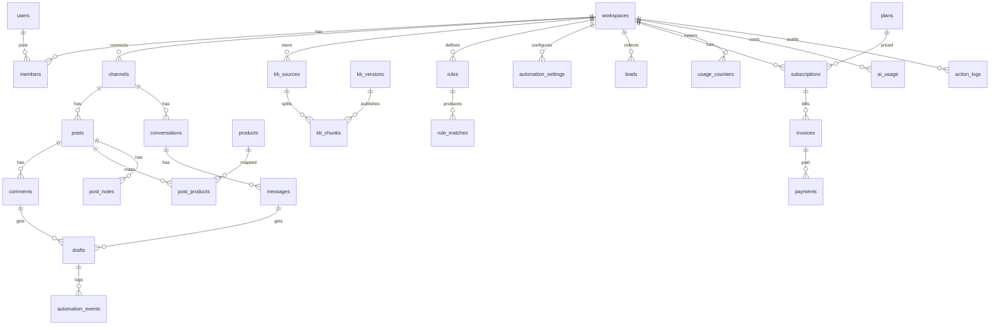

# 10 — Thiết kế Database & ERD

> Phiên bản 1.2 · 03/11/2026 (auth theo Better Auth: `sessions.token`, thêm `accounts`, `verifications`, `two_factors` — ADR 003; biến thể câu, object extract, thành phần độ tin cậy, đánh dấu cài lệnh FR-161–165; thang xử lý khi không chắc, gộp bình luận, bảng size, xung đột giá… FR-147–160; nhiều nhãn, tệp đính kèm, trả lời một phần, xưng hô, `kb_gaps`, độ sẵn sàng FR-141–146; halfvec FR-139, cột định tuyến/viết lại câu hỏi FR-136–137; bổ sung tìm kiếm: tìm sản phẩm gần đúng, bí danh, bảng biến thể, đoạn có ngữ cảnh, hạn hiệu lực, câu mẫu, nhật ký tìm kiếm, cache theo giá; sửa truy vấn full-text; trước đó: saas-core, feature flag, đối soát Shopify, bảo vệ Meta App, kiểm tra lại trước khi gửi) · PostgreSQL 16 + pgvector 0.8.x, extension `unaccent`, `pg_trgm`. Bảng nào đã có trong source hiện tại cần **đối chiếu và migration bổ sung**, không tạo lại. Mọi bảng nghiệp vụ có `workspace_id` + RLS.

## 1. Quy ước

- Khóa chính `id uuid default gen_random_uuid()`; thời gian `timestamptz`; `created_at`, `updated_at`.
- Tiền lưu `bigint` đơn vị VND (không dùng float).
- Định danh nền tảng: `external_id text`, unique theo `(channel_id, external_id)`.
- Xóa mềm (`deleted_at`) cho dữ liệu người dùng tạo; dữ liệu nền tảng xóa cứng khi có yêu cầu xóa.
- Token mã hóa AES-GCM: cột `*_enc bytea` + `key_version int`.
- Enum dùng `text` + CHECK để dễ migration.
- **Schema theo sản phẩm** (`09_System_Architecture.md` §3.1): bảng dùng chung ở schema `core` (users, sessions, accounts, verifications, two_factors, workspaces, members, invitations, plans, subscriptions, invoices, payments, usage_counters, feature_flags, feature_flag_overrides, action_logs, admin_impersonations, notification_prefs, push_subscriptions, data_exports); bảng CommentFlow ở schema `cf`; ExcelFlow sau này ở `xf`. Bảng `core` không có khóa ngoại trỏ sang `cf`/`xf`.

## 2. ERD tổng quan



## 3. Bảng chi tiết

### 3.1 Tổ chức & người dùng

| Bảng | Cột chính | Ghi chú |
|---|---|---|
| `users` | id, email (unique, citext), name, email_verified, image, ~~password_hash~~ (→ `accounts`), ~~totp_secret_enc~~ (→ `two_factors`), totp_enabled, locale, is_admin, admin_role (`super`/`support`/`finance`) | Không có workspace_id |
| `workspaces` | id, name, slug, timezone (mặc định Asia/Ho_Chi_Minh), default_lang, created_by (người tạo; chỉ người này bootstrap được Owner đầu tiên, migration 0016), ai_enabled (mặc định `true` — chỉ cho phép gợi ý; tự gửi vẫn tắt theo `automation_settings`), emergency_stopped_at, ai_cost_cap_usd, status (`trial`/`active`/`past_due`/`suspended`/`deleted`) | |
| `sessions` | user_id, token (ngẫu nhiên, **lưu thô theo Better Auth** — chốt 03/11, ADR 003), created_at, expires_at, last_seen_at (= `updated_at`, ghi tối đa 1 lần/giờ), ip, user_agent, is_admin_session | Không có workspace_id; xóa khi đăng xuất/đổi mật khẩu/đổi quyền. Bù cho token thô: cookie ký HMAC bằng `BETTER_AUTH_SECRET` (khóa ngoài DB, kiểm chữ ký trước khi tra DB), tắt cookie cache, phiên có hạn (13 §2). Bản spec cũ ghi `token_hash` — thay bằng quyết định này |
| `accounts` | user_id, provider_id (`credential`/…), account_id, password (argon2id), access/refresh token (mã hóa nếu có OAuth), created_at, updated_at | Bảng của Better Auth (03/11); mật khẩu nằm ở đây thay cho `users.password_hash` |
| `verifications` | identifier, value, expires_at | Bảng của Better Auth: mã xác minh email, quên mật khẩu |
| `two_factors` | id, user_id, secret (mã hóa), backup_codes (mã hóa — plugin không hỗ trợ băm, ADR 003), verified (mặc định `true`; plugin ghi `false` khi đã tạo secret nhưng chưa xác nhận mã đầu tiên), failed_verification_count (mặc định 0), locked_until (khóa tạm của plugin) | Plugin 2FA của Better Auth; thay cho `users.totp_secret_enc`; `users.totp_enabled` giữ làm cờ |
| `members` | workspace_id, user_id, role (`owner`/`staff`), invited_by, status (`active`/`suspended`/`removed`; CHECK) | unique (workspace_id, user_id). `removed` **giữ dòng, không xóa** (`cf_app` không có quyền DELETE); chỉ thành viên `active` có quyền |
| `invitations` | workspace_id, email (citext), role, token_hash (SHA-256 của token 32 byte; **không lưu token thô**), expires_at (7 ngày), accepted_at, revoked_at, invited_by | Chỉ mục duy nhất **một lời mời đang chờ** cho mỗi (workspace_id, email) (`accepted_at` và `revoked_at` đều NULL). Thu hồi = đặt `revoked_at` (`cf_app` không DELETE; UPDATE chỉ cột `revoked_at`; **`token_hash` không đọc được bằng `cf_app`**, migration 0016). Nhận lời mời qua hàm `core.accept_invitation(token_hash)` (SECURITY DEFINER, không nhận email) — xem §4 và ADR 005 |

### 3.2 Kênh & nội dung nền tảng

| Bảng | Cột chính | Ghi chú |
|---|---|---|
| `channels` | workspace_id, platform (`facebook`/`instagram`/`tiktok`), external_id, name, avatar_url, access_token_enc bytea, key_version int (mặc định 1; xoay khóa — docs/13 §5), token_expires_at, scopes text[], status (`connected`/`expired`/`revoked`/`error`), webhook_subscribed, reply_language (`auto`/`vi`/`en`), capabilities jsonb (hành động connector cho phép: reply, hide, private_reply, message, publish (FR-166, sau GĐ5); giới hạn độ dài/thời gian — FR-016), last_polled_at, send_suspended_until, send_suspended_reason, rate_limit_override jsonb, created_at, updated_at | unique (platform, external_id, workspace_id); unique (workspace_id, id) (đích khóa ngoại ghép). `access_token_enc`/`key_version`: `cf_app` không ghi/đọc trực tiếp — ghi/xóa qua hàm DEFINER (Owner hoặc hệ thống), đọc ciphertext chỉ đường hệ thống (ADR 007 §2, migration 0020); cột `send_suspended_*`, `rate_limit_override`: `cf_app` chỉ đọc (Admin ghi) |
| `posts` | workspace_id, channel_id, external_id, message, permalink, media_url, is_ad, created_time, comment_count, pending_count, created_at, updated_at | unique (workspace_id, id) và (workspace_id, channel_id, id); khóa ngoại ghép (workspace_id, channel_id) → channels (chống gắn chéo workspace) |
| `comments` | workspace_id, channel_id, post_id, external_id, parent_external_id, author_external_id, author_name, text, text_normalized, lang, created_time, label (nhãn chính), label_confidence, label_source (`rule`/`ml`/`llm`/`human`), labels jsonb (`[{label, confidence}]` — FR-145), attachments jsonb (`[{type: photo/video/sticker/gif, url, external_id}]` — FR-143), needs_followup bool + followup_topics text[] (tag "Cần hỗ trợ thêm" — FR-141), merged_into_id (bình luận gộp — FR-148), is_impersonation_suspected bool (FR-155), status, is_hidden, is_own, locked_by, locked_until, external_reply_id, replied_by, replied_at, private_replied_at, deleted_at (khách xóa trên nền tảng — FR-048: ẩn khỏi inbox, GIỮ dòng + log; chỉ hệ thống ghi), text_synced_at (thời điểm theo nền tảng của lần sửa nội dung đã áp dụng gần nhất — lần sửa cũ đến muộn không ghi đè; chỉ hệ thống ghi), redacted_at (khách xóa bình luận → nội dung và danh tính khách bị xóa trắng: `text`='', `text_normalized`/`author_name` NULL, `author_external_id`='', `attachments`='[]' — FR-048; chỉ hàm `cf.mark_comment_deleted` ghi) | unique (channel_id, external_id); index (workspace_id, status, created_time) Khóa ngoại ghép (workspace_id, channel_id), (workspace_id, channel_id, post_id) — bình luận phải thuộc đúng kênh của bài, (workspace_id, merged_into_id) `ON DELETE SET NULL (merged_into_id)`; `unique (workspace_id, id)`; `updated_at` (ADR 007 §3) |
| `conversations` | workspace_id, channel_id, external_id, customer_external_id, customer_name, last_customer_msg_at, window_state (`open`/`human_only`/`closed`), ai_enabled, ai_disabled_reason, assigned_to, status | |
| `messages` | workspace_id, conversation_id, external_id, direction (`in`/`out`), text, lang, sent_by (`customer`/`staff`/`ai`), tag (`HUMAN_AGENT` hoặc null), created_time | |
| `webhook_events` | workspace_id (nullable khi chưa map), platform, event_hash, payload jsonb, status, attempts, error, processed_at timestamptz, created_at | Idempotency + dead letter. `unique nulls not distinct (event_hash, workspace_id)`: một sự kiện một dòng cho mỗi workspace (một Page ở nhiều workspace) và một dòng chưa map. Dòng NULL chỉ ghi bằng hàm DEFINER ở WH-INGEST; `cf_app` không chèn dòng NULL (ADR 007 §4) |
| `comment_replies` | workspace_id, channel_id, comment_id, text (1–8000 ký tự), requested_by (→ users, `set null`), status (`queued`/`sending`/`sent`/`failed`/`cancelled`), attempts (≥ 0), external_reply_id, error_code, previous_status (`new`/`pending_review`/`needs_human`/`send_failed`), sent_at, created_at, updated_at | Hàng đợi gửi trả lời (outbox, ADR 008). Khóa ngoại ghép `(workspace_id, comment_id)` → comments và `(workspace_id, channel_id)` → channels (xóa lan). `unique (workspace_id, comment_id) where status in ('queued','sending')` (một yêu cầu đang hoạt động cho mỗi bình luận); `unique (channel_id, external_reply_id) where external_reply_id is not null`. `error_code` chỉ chứa mã (mã `PlatformError`, `recheck:R#`, `connector_unavailable`, `cancelled_by_user`, `retries_exhausted`) — không chứa nội dung/token. Khi dựng `drafts` (GĐ2) sẽ liên kết `draft_id` |

**Trạng thái bình luận** (`comments.status`): `new`, `processing`, `pending_review`, `needs_human`, `scheduled_auto`, `sending`, `replied`, `auto_replied`, `send_failed`, `skipped`, `spam_suspected`, `hidden`.

### 3.3 AI & tự động hóa

| Bảng | Cột chính | Ghi chú |
|---|---|---|
| `drafts` | workspace_id, target_type (`comment`/`message`), target_id, text, lang, sources jsonb, confidence, needs_human, reason, model, prompt_version, kb_version, status (`suggested`/`sent_as_is`/`edited`/`discarded`/`auto_sent`/`would_send`), not_auto_sent_reason, failed_gate (ví dụ `gate:5` hoặc `recheck:R5`), final_text, edit_distance, trace_id, action (`answer`/`clarify`/`redirect`/`handoff` — FR-147), variants jsonb (3–5 câu cùng nội dung — FR-161), chosen_variant smallint, confidence_components jsonb (FR-163), extracted jsonb (object của bước `extract` — FR-162), claims jsonb (`[{text, source_ids, kind: fact/greeting/question_back/handoff}]` — FR-140, FR-141), unanswered_topics text[] (FR-141), context_refs jsonb (id các lượt hội thoại đã ghép — FR-144), price_snapshot jsonb (`[{product_id, variant_id, price_vnd, stock, updated_from_source_at}]` lúc soạn — dùng cho `sendRecheck` R5) | Nguồn dữ liệu hiệu chuẩn |
| `automation_settings` | workspace_id, scope (`workspace`/`channel`/`post`), scope_id, target (`comment`/`message`), label, lang (`all`/`vi`/`en` — FR-120), mode (`off`/`shadow`/`auto`), threshold, delay_seconds, daily_cap, active_hours jsonb, blocked_keywords text[], allow_partial bool default false (FR-141), allow_clarify bool default true (FR-147), merge_window_seconds int default 30 (FR-148), stock_stale_days int default 3 (FR-151), human_hold_minutes int default 120 (FR-154), suggest_alternatives bool default false (FR-157) | unique (workspace_id, scope, scope_id, target, label, lang) |
| `automation_events` | workspace_id, draft_id, event (`would_send`/`auto_sent`/`cancelled`/`blocked`/`marked_wrong`/`paused`), gate, reason, actor_id | |
| `ai_usage` | workspace_id, draft_id, step, model, input_tokens, output_tokens, cached_tokens, cost_usd numeric(12,6), cache_hit, created_at | Tổng hợp theo ngày |
| `brand_voice` | workspace_id, lang, tone, greeting, sign_off, do text[], dont text[], address_by_name bool default false (FR-161), shop_pronoun (`em`/`shop`/`minh`/`custom` + shop_pronoun_custom), customer_address (`anh_chi`/`ban`/`quy_khach`/`you`), handoff_templates jsonb (câu mời theo chủ đề `shipping`/`discount`/`order_status`/`stock_check`/`other`, mỗi chủ đề có bản trong giờ và ngoài giờ — FR-141, FR-152) | Theo ngôn ngữ; FR-142 |
| `size_charts` | workspace_id, product_id (null = theo danh mục), category, size, height_min_cm, height_max_cm, weight_min_kg, weight_max_kg, measures jsonb (ngực/eo/mông…), note | FR-149; tra bằng SQL |
| `post_price_mentions` | workspace_id, post_id, amount_vnd, text_span, product_id, matches_stock bool, checked_at | FR-150a; tính khi bài/quảng cáo được đồng bộ hoặc giá đổi |
| `kb_gaps` | workspace_id, topic (`shipping`/`discount`/`product_info`/`policy`/`order_status`/`size`/`other`), sample_question_masked, product_id, count, first_seen_at, last_seen_at, status (`open`/`resolved`/`ignored`), resolved_by_source_id | FR-141, FR-134; gộp theo (workspace_id, topic, product_id) |
| `readiness_checks` | workspace_id, lang, checklist jsonb (mục bắt buộc đã có/thiếu), sample_pass_rate numeric, score numeric, kb_version, computed_at | FR-146; tính lại khi xuất bản kiến thức |
| `abbreviations` | workspace_id (null = hệ thống), short, full, lang | |

### 3.4 Kiến thức

| Bảng | Cột chính | Ghi chú |
|---|---|---|
| `kb_sources` | workspace_id, type (`manual`/`faq`/`excel`/`shopify`/`url`/`policy`), title, origin_url, external_key (ổn định), status, last_synced_at, sync_error, deleted_at | |
| `kb_chunks` | workspace_id, source_id, version_id, chunk_key, injection_suspected bool + injection_reason (FR-164; true → không xuất bản tự động), content, lang, content_hash, embedding halfvec(1024), tsv tsvector, metadata jsonb, is_draft, **context_header** text (nguồn › mục › tên sản phẩm — FR-130), **product_id** (null = kiến thức chung), **valid_from**, **valid_until** (FR-131), **embedding_model** text (tên + revision — FR-133) | Index B-tree (workspace_id, version_id); GIN (tsv); HNSW (embedding) khi lớn; B-tree (workspace_id, product_id); B-tree (workspace_id, embedding_model) |
| `kb_versions` | workspace_id, number, published_by, published_at, note, changed_categories text[] | |
| `kb_tests` | workspace_id, question, lang, expected_label, expected_contains, last_result jsonb | |
| `kb_connections` | workspace_id, provider (`google_sheets` / `shopify` / `haravan` / `sapo` / `kiotviet` / `pancake`), shop_domain (hoặc mã sheet / mã cửa hàng), sync_interval, access_token_enc, scopes, status, webhook_ok_at, last_reconciled_at | |
| `reconcile_runs` | workspace_id, connection_id, started_at, finished_at, products_checked, diffs_count, webhooks_reregistered, status, error | Đối soát Shopify (09 §7.3) |
| `reconcile_diffs` | workspace_id, run_id, product_id, field (`price`/`compare_at`/`stock`/`status`/`name`/`policy`), old_value, source_value, action (`updated`/`archived`/`queued_review`) | |
| `faq_items` | workspace_id, question, answer, lang, tags | Bản gốc FAQ thủ công |
| `products` | workspace_id, source (`manual`/`excel`/`google_sheets`/`shopify`/`haravan`/`sapo`/`kiotviet`/`pancake`), external_id, name, sku, price_vnd bigint, compare_at_vnd, stock, variants jsonb (bản gốc từ nguồn, giữ để đối chiếu), url, locked_fields text[], updated_from_source_at, **search_text** text (tên + SKU + thuộc tính + bí danh, viết thường, đã `unaccent` — app tính khi ghi), **name_embedding** halfvec(1024), **rev** bigint (tăng mỗi khi giá/tồn/trạng thái/biến thể đổi — FR-135), status (`active`/`archived`), category (danh mục — FR-157) | **Giá/tồn đọc trực tiếp**; GIN `gin_trgm_ops` (search_text); HNSW (name_embedding) khi lớn (FR-127) |
| `product_variants` | workspace_id, product_id, external_id, sku, attrs jsonb (`{"size":"M","color":"đen"}`), attrs_norm jsonb (khóa/giá trị chuẩn hóa: `mau`→`color`, `đen`/`den`/`black`→`black`), price_vnd bigint, compare_at_vnd, stock, status, updated_from_source_at | **Nguồn đúng cho giá/tồn theo biến thể** (FR-129); GIN (attrs_norm); unique (workspace_id, product_id, external_id). `price_snapshot` và `sendRecheck` R5 đọc bảng này |
| `product_aliases` | workspace_id, product_id, alias, alias_norm (viết thường, `unaccent`), source (`staff`/`import`/`ai_suggested`), confirmed_by, created_at | FR-128; GIN `gin_trgm_ops` (alias_norm); unique (workspace_id, alias_norm, product_id); `ai_suggested` chỉ dùng khi đã có người xác nhận |
| `post_products` | workspace_id, post_id, product_id, is_primary, confirmed_by, suggested_by_ai | |
| `post_notes` | workspace_id, post_id, content, valid_from, valid_to | |
| `kb_answer_examples` | workspace_id, channel_id (null = mọi kênh), label, lang, question_masked, answer_template (số tiền/tồn kho thay bằng `{price:<variant_id>}`, `{stock:<variant_id>}`), product_ids uuid[], embedding halfvec(1024), source_draft_id, approved_by, status (`active`/`disabled`), kb_version, used_count, created_at | FR-132; chỉ lấy từ câu nhân viên gửi nguyên văn hoặc đã sửa; Owner tắt được từng mẫu; tối đa 2.000 mẫu/workspace (giữ mẫu mới + dùng nhiều) |
| `retrieval_logs` | workspace_id, draft_id, query_masked, lang, kb_version, route (`sql`/`hybrid`/`both` — FR-136), search_query_masked (FR-137), candidates jsonb (`[{chunk_id, vec_rank, fts_rank, trgm_rank, rerank_score}]`), used_chunk_ids uuid[], resolved_product_ids uuid[], latency_ms, created_at | FR-134; lưu 90 ngày; không lưu nội dung chưa che PII |

**Kiểu vector (FR-139):** mọi cột embedding là `halfvec(1024)` (pgvector ≥ 0.7), index `hnsw (embedding halfvec_cosine_ops)`; tham số truy vấn ép kiểu `$1::halfvec`.

**Văn bản đem đi lập chỉ mục (FR-130):** `embedding` và `tsv` tính trên `context_header + "\n" + content`, không chỉ `content`; `content` giữ nguyên để hiển thị và trích dẫn.

**tsvector theo ngôn ngữ đoạn:** `lang = 'vi'` → `to_tsvector('simple', unaccent(content))` (không có bộ tách từ tiếng Việt chuẩn trong Postgres; `unaccent` cho phép tìm có dấu/không dấu); `lang = 'en'` → `to_tsvector('english', content)` (có stemming). Câu hỏi dùng cùng cấu hình theo ngôn ngữ đã nhận diện; câu trộn → chạy cả hai và trộn bằng RRF.

### 3.5 Spam, khách tiềm năng

| Bảng | Cột chính |
|---|---|
| `rules` | workspace_id, name, type (`keyword`/`regex`/`phone`/`link`/`emoji_only`/`tag_only`), pattern, action (`mark`/`auto_hide`/`skip`), enabled, shadow_until |
| `rule_matches` | workspace_id, rule_id, comment_id, action_taken, reverted |
| `leads` | workspace_id, channel_id, source_type, source_id, name, phone_enc, phone_last4, note, stage (`new`/`contacted`/`won`/`lost`), assigned_to |

### 3.6 Thanh toán & hạn mức

| Bảng | Cột chính | Ghi chú |
|---|---|---|
| `plans` | product (`commentflow`/`excelflow`), code (`trial`/`starter`/`growth`/`business`/`addon_1000`), price_vnd, channels_limit, monthly_turns, auto_reply_allowed | Starter 299k/1/1.000/không; Growth 699k/3/3.000; Business 1.490k/10/7.500; add-on 149k/+1.000; trial 14 ngày/300 |
| `subscriptions` | workspace_id, product — unique (workspace_id, product), plan_code, status, period_start, period_end, cancel_at | |
| `invoices` | workspace_id, product, number, amount_vnd, items jsonb, status (`pending`/`paid`/`void`), transfer_code (nội dung CK bắt buộc), due_at | |
| `payments` | workspace_id, invoice_id, amount_vnd, bank_ref, raw_statement, confirmed_by, confirmed_at | |
| `usage_counters` | workspace_id, product, meter (CommentFlow: `ai_turns`), period_start, used, limit, addon, warned_80_at, blocked_at | 1 lượt = 1 lần AI soạn; unique (workspace_id, product, meter, period_start) |
| `daily_stats` | workspace_id, date, channel_id, comments_in, replied, auto_replied, median_response_sec, edited_rate, cost_usd | Báo cáo |

### 3.7 Nhật ký, thông báo, quyền riêng tư

| Bảng | Cột chính |
|---|---|
| `action_logs` | workspace_id, actor_type (`user`/`ai`/`system`/`admin`), actor_id, action, target_type, target_id, before jsonb, after jsonb, impersonation_id, ip |
| `admin_impersonations` | admin_id, workspace_id, reason, started_at, expires_at (30 phút), read_only |
| `notification_prefs` | workspace_id, user_id, event, channel (`inapp`/`email`/`push`), enabled |
| `push_subscriptions` | user_id, endpoint, keys jsonb |
| `deletion_requests` | platform, external_user_id, confirmation_code, status, reason, completed_at |
| `data_exports` | workspace_id, requested_by, status, file_key, expires_at |

### 3.8 Feature flag & bảo vệ gửi

| Bảng | Cột chính | Ghi chú |
|---|---|---|
| `feature_flags` | key (PK), product (`core`/`commentflow`/`excelflow`), description, kind (`release`/`ops`/`kill_switch`/`plan`), default_on, rollout_percent, plans text[], owner, expires_at | Không có workspace_id; chỉ Super Admin ghi |
| `feature_flag_overrides` | flag_key, workspace_id, enabled, reason, set_by, created_at | unique (flag_key, workspace_id) |
| `abuse_signals` | workspace_id, channel_id, signal (`marked_wrong_rate`/`removed_after_send`/`graph_368`/`volume_spike`/`banned_keyword`), value, threshold, action_taken, resolved_by, resolved_at | Job `abuse` (09 §11.2) |
| `app_usage_samples` | sampled_at, app_usage_pct, buc_usage jsonb | Từ header Graph API; giữ 7 ngày |

Bộ đếm giới hạn tốc độ (token bucket) nằm trong Redis, không lưu DB.

## 4. RLS

```sql
alter table comments enable row level security;
create policy ws_isolation on comments
  using (workspace_id = current_setting('app.workspace_id')::uuid)
  with check (workspace_id = current_setting('app.workspace_id')::uuid);
```

- Mỗi request/job đặt `set local app.workspace_id = ...` trong transaction.
- Role DB của app **không** có `BYPASSRLS`; Admin dùng role riêng + ghi nhật ký.
- Test CI: mỗi bảng có `workspace_id` phải có policy (script kiểm `pg_policies`).
- **Ngữ cảnh và role** (đặt bằng `set local` trong giao dịch): `app.workspace_id` (`withWorkspace`), `app.user_id` (`withUser`, dữ liệu **của chính mình**). **Bảng xác thực** (`users`, `sessions`, `accounts`, `verifications`; `two_factors` khi có) chỉ thấy **toàn bộ** trong `app.ctx = 'auth'` qua **pool riêng của role `cf_auth`** (chỉ module auth của saas-core import — luật dependency-cruiser `chi-auth-import-auth-db`); `cf_auth` chỉ có quyền trên các bảng đó, không có quyền nào trên bảng nghiệp vụ, và policy của nó đòi cả role lẫn `app.ctx`. `cf_app` không còn ngữ cảnh `auth`. *Trạng thái:* **đã áp**; `two_factors` áp cùng mẫu ngay khi tạo bảng (`check-rls` đỏ nếu thiếu). **Không ngữ cảnh → không thấy dòng nào.**

  | Bảng | `cf_app` không ngữ cảnh | `withUser(u)` | `withWorkspace(W)` | `cf_auth` + `app.ctx = 'auth'` |
  |---|---|---|---|---|
  | `sessions`, `accounts` | 0 dòng | **chỉ đọc** dòng của mình (không cột `token`, `password`, token OAuth); không ghi | 0 dòng | thấy/ghi tất cả (`sessions`: UPDATE theo cột) |
  | `verifications` | không có quyền | không có quyền | không có quyền | thấy/ghi tất cả |
  | `two_factors` | không có quyền | không có quyền | không có quyền | đọc/ghi **chỉ trong `app.ctx = 'auth'`**; UPDATE chỉ 5 cột `secret`, `backup_codes`, `verified`, `failed_verification_count`, `locked_until` (không sửa `user_id`/`id`) — migration 0013, 0014 |
  | `users` | 0 dòng | chỉ đọc dòng của mình (**7 cột**, xem dưới); **chỉ ghi `name`, `image`, `locale`** (+ `updated_at`) | chỉ thành viên `active` của W (**7 cột**); không ghi | thấy/ghi tất cả, trừ `is_admin`/`admin_role`; **INSERT chỉ người không phải Admin** (policy RESTRICTIVE, migration 0011) |

  **Cột `users` mà `cf_app` đọc được (migration 0012) — đúng 7 cột:** `id`, `email`, `name`, `image`, `locale`, `created_at`, `updated_at`. `email_verified`, `totp_enabled`, `is_admin`, `admin_role` (và mọi cột thêm sau này) **không** đọc được bằng `cf_app`; trạng thái của người đang đăng nhập chỉ lấy từ phiên Better Auth phía server, không nhận từ client. `check-rls` đối chiếu danh sách 7 cột này. **Chặn tạo/nâng Admin (migration 0011):** `cf_auth` có INSERT cả bảng `users` nên policy RESTRICTIVE `users_auth_no_admin_insert` (`WITH CHECK (NOT is_admin AND admin_role IS NULL)`) chỉ cho chèn người không phải Admin; UPDATE `is_admin`/`admin_role` bị chặn bằng quyền cột; cấp quyền Admin chỉ qua role chủ sở hữu/Admin riêng. `check-rls` đỏ nếu policy này bị gỡ. Đổi mật khẩu, email, `email_verified`, `totp_enabled` và tạo/xóa phiên **chỉ qua luồng Better Auth** (`cf_auth`). Điều kiện "của mình" luôn đòi không có `app.workspace_id` và có `app.user_id` (đặt cả hai vẫn không mở rộng quyền). **Phiên Admin:** trigger `core.cap_admin_session` ép `expires_at ≤ created_at + 8 giờ` ở INSERT **và** UPDATE, `created_at` không ở tương lai (INSERT) và chỉ được lùi (UPDATE), chỉ người dùng `is_admin = true` có `is_admin_session = true`; `cf_app` không UPDATE được bảng `sessions` (nên không đổi được `is_admin_session`/`created_at`), `cf_auth` chỉ UPDATE `expires_at`, `updated_at`, `ip`, `user_agent` (ADR 003).
- **Lời mời và Owner cuối cùng (migration 0015, ADR 005):** `core.invitation_preview(token_hash)` và `core.accept_invitation(token_hash)` là hàm `SECURITY DEFINER` với `search_path = pg_catalog, core`, chỉ `EXECUTE` cho `cf_app`; `accept_invitation` lấy người dùng từ `app.user_id` (`withUser`, đòi không có `app.workspace_id`), đọc `users.email`/`email_verified` trong hàm để so khớp, mọi ca không hợp lệ trả 0 dòng. Trigger `members_guard_last_owner` giữ workspace luôn còn ≥ 1 Owner `active`. `accept_invitation` bỏ qua workspace `deleted`, không hạ vai trò thành viên đang `active` (chỉ nâng), kích hoạt lại thành viên `removed`, không mở khóa `suspended`, ghi `action_logs`.
- **Ngữ cảnh người gọi (`withActor`, migration 0016, ADR 005 §3):** `withActor(workspaceId, userId, fn)` đặt cả `app.workspace_id` và `app.user_id`. Policy chỉ-Owner dựa vào `core.is_workspace_owner()` (SECURITY DEFINER, STABLE, search_path cố định): `members` UPDATE (không sửa được dòng đã `removed` — đưa lại chỉ qua lời mời, migration 0018; `cf_app` chỉ UPDATE `role`/`status`/`updated_at`), `workspaces` UPDATE chỉ các cột `name`/`slug`/`timezone`/`default_lang`/`ai_enabled`/`updated_at` (0018: không `status`, `ai_cost_cap_usd`, `emergency_stopped_at`, `created_by`), và `members` INSERT **chỉ còn đường khởi tạo** (migration 0017: thành viên khác vào qua `accept_invitation`, không ai — kể cả Owner — thêm thẳng): người tạo tự thêm mình làm Owner khi `workspace_bootstrap_open()` — workspace do chính người gọi tạo (`workspaces.created_by`) và chưa có thành viên; workspace do seed/Admin/job tạo (created_by NULL) không ai chiếm được; `workspaces` INSERT đòi `created_by` = người gọi; `members` chỉ UPDATE được `role`, `status`, `updated_at`; `invited_by` nếu có phải là người gọi), `invitations` SELECT/INSERT/UPDATE, `workspaces` UPDATE. `action_logs` INSERT: `actor_type='user'` đòi `actor_id = app.user_id` và người đó là thành viên `active` (`is_workspace_member()`); chỉ `system`/`ai` (actor_id NULL) khi không có người dùng; `admin` chưa có đường ghi (Admin Console sẽ có role/hàm riêng). `withWorkspace` thuần (job, hệ thống) vẫn đọc được `members` nhưng không ghi được các bảng trên. Giới hạn: `app.user_id` do mã ứng dụng đặt (không chống tiến trình web bị chiếm hoàn toàn).
- **Đọc chéo workspace** (thấy các workspace khác của chính mình) **chỉ khi không có `app.workspace_id`**; trong `withWorkspace(A)` chỉ thấy A. Thành viên không `active` không được liệt kê.
- Hàm `core.current_workspace_id()` / `core.current_user_id()` dùng `NULLIF(current_setting(..., true), '')`: thiếu giá trị → NULL → 0 dòng (sau COMMIT/ROLLBACK biến tùy chỉnh về chuỗi rỗng, không phải NULL).
- Quyền của `cf_app`: **không DELETE** trên `workspaces`, `users`, `members` (xóa mềm bằng `status`); **không UPDATE** `users.is_admin`/`admin_role` (chỉ role Admin riêng); `action_logs`, `ai_usage` chỉ SELECT + INSERT. `check-rls` kiểm mỗi quyền của `cf_app` có policy đúng lệnh và dựa vào `current_workspace_id()`.
- Policy tách theo lệnh (SELECT/INSERT/UPDATE/DELETE) thay cho một policy `ws_isolation` duy nhất như mẫu trên.
- **Kênh và nội dung nền tảng (migration 0019–0020, ADR 007):** ba đường — người dùng (`withActor`), **hệ thống** (`withJob`: `app.ctx = 'system'` → `core.is_system_context()`) và `withWorkspace()` trần (chỉ ĐỌC; quên `withActor` ở route web thì bị từ chối ghi).

  | Bảng | SELECT | INSERT | UPDATE | DELETE |
  |---|---|---|---|---|
  | `channels` | hệ thống/trần hoặc thành viên đang hoạt động (không cột token/`key_version`) | **không** (tạo qua `cf.create_channel`, Owner hoặc hệ thống) | Owner hoặc hệ thống; đường người dùng chỉ đổi `name`, `reply_language` (trigger) | không |
  | `posts` | như trên | chỉ hệ thống | chỉ hệ thống | không |
  | `comments` | như trên | chỉ hệ thống | thành viên đang hoạt động hoặc hệ thống; đường người dùng không sửa `text`, `text_normalized`, `lang`, `author_name`, `attachments`, `is_own`, `is_impersonation_suspected`, `external_reply_id`, `replied_at`, `private_replied_at`, `replied_by`, `deleted_at`, `text_synced_at`, `redacted_at`, `author_external_id`; `label_source` chỉ đặt `human`; `locked_by` chỉ là chính người gọi/NULL, không ghi đè khóa còn hạn của người khác; chỉ chuyển trạng thái giữa `skipped`/`pending_review`/`needs_human` (trigger 0023–0025) | không |
  | `webhook_events` | Owner đang hoạt động hoặc hệ thống | **không INSERT trực tiếp** — chỉ qua hàm DEFINER `cf.record_webhook_event` (ngữ cảnh trần của route webhook, sau khi kiểm chữ ký) | chỉ hệ thống (`status`, `attempts`, `error`, `processed_at`) | không |
  | `comment_replies` | thành viên đang hoạt động hoặc hệ thống | **không INSERT trực tiếp** — chỉ qua hàm DEFINER `cf.request_comment_reply` | chỉ hệ thống (worker, job `send`), chỉ các cột `status`, `attempts`, `external_reply_id`, `error_code`, `sent_at`, `updated_at` (`text`, `requested_by`, `workspace_id`, `comment_id`, `channel_id`, `previous_status` không sửa được) | không |

  Hàm token Page (SECURITY DEFINER, `search_path = pg_catalog, core, cf, pg_temp`, chỉ `EXECUTE` cho `cf_app`): `cf.create_channel`, `cf.set_channel_token`, `cf.clear_channel_token` — Owner đang hoạt động hoặc hệ thống; `cf.read_channel_token` — **chỉ hệ thống** (worker giải mã; web không đọc được ciphertext). Mã hóa AES-256-GCM chạy trong mã ứng dụng, AAD = `workspace_id|channel_id|key_version`.

  Hàm trả lời bình luận (SECURITY DEFINER, `search_path = pg_catalog, core, cf, pg_temp`, chỉ `EXECUTE` cho `cf_app`, migration 0023): `cf.request_comment_reply(comment_id, text)` — thành viên `active` (Owner hoặc Staff); bình luận ở workspace hiện tại, chưa trả lời/ẩn/gộp/xóa trên nền tảng (`deleted_at`), trạng thái ∈ {`new`, `pending_review`, `needs_human`, `send_failed`}; kênh `connected`; không ai khác giữ khóa mềm còn hạn; nội dung 1–8000 ký tự sau khi cắt khoảng trắng đầu/cuối → tạo yêu cầu `queued`, đặt bình luận `sending`, ghi `action_logs` (không kèm nội dung); lỗi nghiệp vụ trả SQLSTATE `CF404` (không thấy), `CF409` (không trả lời được ở trạng thái này), `CF423` (người khác giữ khóa), `CF424` (kênh không kết nối), `CF422` (nội dung không hợp lệ), `42501` (không có quyền). `cf.cancel_comment_reply(reply_id)` — chỉ người yêu cầu, chỉ yêu cầu còn `queued`, trả bình luận về `previous_status`.

  **Hàm `cf.mark_comment_deleted(channel_id, external_id, deleted_at)` (SECURITY DEFINER, `search_path = pg_catalog, core, cf, pg_temp`, `EXECUTE` chỉ `cf_app`, migration 0025; chỉ đường hệ thống — `core.is_system_context() IS TRUE` và có workspace, ngoài ra SQLSTATE `42501`):** khi khách xóa bình luận, đặt `deleted_at` (giờ sự kiện hoặc `now()`), `redacted_at`, xóa trắng `text`, `text_normalized`, `author_name`, `author_external_id`, `attachments`; GIỮ dòng, `status`, `created_time`, `external_id`, `comment_replies`, `action_logs`; xóa payload (`{}`) các sự kiện tạo/sửa của chính bình luận trong `cf.webhook_events` (dòng chưa xử lý/đang lỗi → `dead`, `error='redacted'`). Phần xóa payload chạy kể cả khi chưa có/đã xóa dòng (sự kiện đến trước hoặc muộn); phần xóa trắng dòng chỉ lần đầu (đã xóa/không có dòng → trả NULL). Triển khai: migrate rồi bật worker mới ngay. `cf_app` không còn quyền cột `UPDATE (deleted_at)` — đường duy nhất là hàm này. Migration 0025 cũng xóa trắng các bình luận đã `deleted_at` từ trước. Nội dung đã xóa trắng không khôi phục được (cố ý).

  **Trigger `cf.guard_comment_user_update` (migration 0023, thêm `deleted_at` ở migration 0024, `redacted_at`/`author_external_id` ở migration 0025):** miễn chủ bảng (hàm DEFINER) và đường hệ thống (worker); đường người dùng **không** đặt được trạng thái hệ thống (`sending`, `replied`, `auto_replied`, `send_failed`, `scheduled_auto`, `processing`, `spam_suspected`, `hidden`), **dòng đã xóa trắng (`redacted_at` có giá trị) không vai nào ngoài chủ bảng được ghi lại `text`, `text_normalized`, `author_name`, `author_external_id`, `attachments`, `deleted_at`, `redacted_at` — kể cả đường hệ thống**, không đổi trạng thái khi bình luận đang ở trạng thái hệ thống (chỉ chuyển giữa `skipped`/`pending_review`/`needs_human` từ `new`/`pending_review`/`needs_human`/`send_failed`/`skipped`/`spam_suspected`), không sửa `text`, `text_normalized`, `lang`, `author_name`, `attachments`, `is_own`, `is_impersonation_suspected`, `external_reply_id`, `replied_at`, `private_replied_at`, `replied_by`, `deleted_at`, `text_synced_at`; `label_source` chỉ đặt được `human`; `locked_by` chỉ đặt được là chính người gọi hoặc NULL và không ghi đè/xóa khóa còn hạn của người khác.

## 5. Truy vấn tìm kiến thức (hybrid)

```sql
with v as (
  select id, row_number() over (order by embedding <=> $1) r
  from kb_chunks where workspace_id = $ws and version_id = $ver
  order by embedding <=> $1 limit 30
), t as (
  select id, row_number() over (order by ts_rank(tsv, q) desc) r
  from kb_chunks, websearch_to_tsquery($cfg::regconfig, $q_text) q  -- $cfg: 'simple' (vi, $q_text đã unaccent) hoặc 'english' (en)
  where workspace_id = $ws and version_id = $ver and tsv @@ q
  order by ts_rank(tsv, q) desc limit 30   -- sửa 02/11: thiếu order by thì lấy 30 dòng bất kỳ
)
select id, sum(1.0 / (60 + r)) score
from (select * from v union all select * from t) x
group by id order by score desc limit 20;
```

Sau đó rerank top 20 → lấy 5. Bật `hnsw.iterative_scan = relaxed_order` khi dùng HNSW với lọc.

**Bộ lọc bắt buộc cho cả hai nhánh `v` và `t` (bổ sung 02/11):** `and (valid_from is null or valid_from <= now()) and (valid_until is null or valid_until > now())` (FR-131); khi bài đã gắn sản phẩm: `and (product_id is null or product_id = any($post_products))` để không lấy đoạn của sản phẩm khác.

### 5.1 Tìm sản phẩm (FR-127, FR-128)

Chạy trước tìm kiến thức; dừng ở bước đầu tiên có kết quả đủ tin cậy:

```sql
-- 1) sản phẩm gắn bài (post_products) — luôn ưu tiên
-- 2) bí danh khớp: similarity(alias_norm, $q_norm) >= 0.6
select product_id, max(similarity(alias_norm, $q_norm)) s
from product_aliases where workspace_id = $ws and alias_norm % $q_norm
group by product_id order by s desc limit 5;
-- 3) tên/SKU gần đúng (chịu gõ sai, không dấu)
select id, similarity(search_text, $q_norm) s
from products where workspace_id = $ws and status = 'active' and search_text % $q_norm
order by s desc limit 10;
-- 4) theo nghĩa: name_embedding <=> $q_vec, limit 10
-- Trộn 3 + 4 bằng RRF; điểm cao nhất < ngưỡng → không chọn, để AI hỏi lại khách hoặc chuyển người
```

`$q_norm` = câu đã chuẩn hóa (viết thường, `unaccent`, mở rộng viết tắt). Đặt `pg_trgm.similarity_threshold` theo bộ đánh giá (khởi điểm 0,3).

### 5.2 Biến thể, giá, tồn kho (FR-129)

Thuộc tính khách hỏi (size, màu) được tách ở bước chuẩn hóa thành `{size, color}` đã chuẩn hóa, rồi tra bằng SQL — **không** qua vector:

```sql
select id, attrs, price_vnd, stock from product_variants
where workspace_id = $ws and product_id = any($products) and status = 'active'
  and attrs_norm @> $wanted::jsonb;   -- ví dụ {"size":"m","color":"black"}
```

Không có dòng nào → câu trả lời nói rõ "hết/không có" theo dữ liệu, không đoán.

### 5.3 Cache an toàn với giá (FR-135)

Giá trị cache lưu kèm `product_revs = {product_id: rev}` của các sản phẩm đã dùng. `cacheLookup` so với `products.rev` hiện tại; lệch một sản phẩm → coi như trượt cache. Khóa cache vẫn gồm `workspace_id` + `kb_version`.

**Bổ sung FR-161:** giá trị cache câu trả lời lưu cả `variants[]`; câu đã gửi ghi hash vào Redis `cf:{ws}:post:{post_id}:recent` (TTL 1 giờ) để không lặp chữ.

### 5.4 Câu mẫu của shop (FR-132)

`select ... from kb_answer_examples where workspace_id = $ws and status = 'active' and lang = $lang and (label = $label) order by embedding <=> $q_vec limit 3` → đưa vào prompt soạn làm ví dụ giọng văn. Placeholder `{price:…}`/`{stock:…}` được điền lại bằng giá/tồn **hiện tại** từ `product_variants` trước khi đưa vào prompt; không còn biến thể → bỏ mẫu đó.

## 6. Migration & dữ liệu

- Công cụ migration chốt trong `docs/decisions/001-stack.md` khi dựng khung (GĐ0); RLS và index vector viết SQL thuần.
- Thời gian lưu: bình luận/tin nhắn 12 tháng (đề xuất, cần chốt); `ai_usage` gộp theo ngày sau 90 ngày; `webhook_events` 30 ngày.
- Seed: chỉ `plans` và `abbreviations` hệ thống. **Không seed dữ liệu khách giả.**
