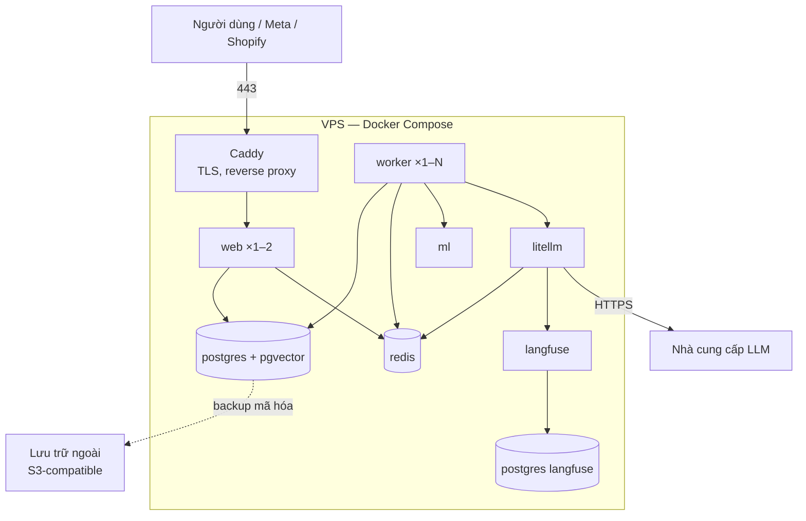
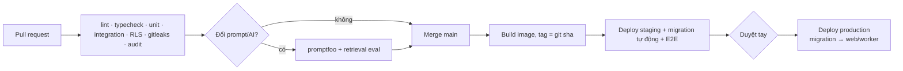

# 15 — Kiến trúc triển khai

> Phiên bản 0.6 · 02/11/2026 · Giai đoạn đầu ưu tiên chi phí thấp: 1 VPS + Docker Compose. Cấu hình máy và nhà cung cấp chọn theo đo thực tế; giá VPS phải kiểm tại thời điểm thuê.

## 1. Môi trường

| Môi trường | Mục đích | Hạ tầng | Dữ liệu |
|---|---|---|---|
| `local` | Phát triển | **Chốt 02/11: máy code không cài Docker.** Next.js, worker, test chạy bằng Node trên máy code; Postgres + Redis (dev và test) + `ml`, LiteLLM, Langfuse chạy bằng Docker Compose trên **máy phụ** (máy ảo Ubuntu trong Hyper-V, cùng mạng LAN), project Compose `cf-dev` tách khỏi `cf-staging` | Seed tối thiểu; **không token production**; DB dev/test chỉ mở cho IP máy code |
| `staging` | Kiểm thử tích hợp, E2E, chạy thử với Page thật (đưa lên sớm từ GĐ1) | **Máy phụ** (máy ảo Ubuntu, project Compose `cf-staging`, deploy bằng GitHub self-hosted runner, ra internet qua Cloudflare Tunnel); sau này có thể chuyển VPS | Meta App dev + Page test, Shopify dev store |
| `production` | Khách thật | VPS riêng | Dữ liệu thật, sao lưu hằng ngày |

## 2. Sơ đồ production

> **Chốt 02/11:** đủ 7 dịch vụ từ GĐ0 (local bằng Docker Compose), staging + production trên VPS **tại Việt Nam** từ GĐ3; Langfuse tự host cùng VPS (thêm ClickHouse, MinIO). Sơ đồ dưới là cấu hình chạy thật.

- Chỉ Caddy mở cổng 80/443; các dịch vụ khác trong mạng Docker nội bộ.
- Langfuse dùng database riêng (cùng instance Postgres hoặc instance riêng tùy tải).
- `ml` chạy CPU ở giai đoạn đầu (bge-m3 + reranker); theo dõi RAM.

## 3. Cấu hình máy (ước lượng ban đầu, cần đo)

| Thành phần | Ước lượng |
|---|---|
| **Chốt 02/11** | Máy chủ đặt **tại Việt Nam**; đủ 7 dịch vụ từ GĐ0; quy mô năm đầu < 50 shop; Langfuse **tự host cùng VPS** |
| Tổng | **8 vCPU / 32 GB RAM / SSD ≥ 200 GB** (Langfuse tự host cần thêm ClickHouse + Redis + kho file kiểu S3/MinIO) |
| `ml` | 2–4 GB RAM (bge-m3 + reranker) |
| `postgres` | 2–4 GB RAM |
| `langfuse` (web + worker + ClickHouse + MinIO) | 4–6 GB RAM — đo lại, giới hạn bộ nhớ ClickHouse |

Khi `ml` hoặc Postgres thành nút cổ chai → tách sang máy riêng trước khi scale web.

## 4. Docker Compose

- File: `infra/docker-compose.yml` (chung) + `docker-compose.prod.yml` / `.staging.yml` (ghi đè).
- **Ghim phiên bản image** bằng tag cụ thể (và digest cho image bên thứ ba): postgres, pgvector, redis, litellm, langfuse, caddy.
- Model `ml`: ghim tên + revision Hugging Face; tải sẵn vào image hoặc volume, không tải lúc chạy production.
- Healthcheck mọi service; `restart: unless-stopped`; giới hạn RAM theo service.
- Volume: `pgdata`, `redisdata` (AOF), `models`, `caddy_data`.

## 5. Biến môi trường & bí mật

| Nhóm | Ví dụ |
|---|---|
| App | `APP_URL`, `SESSION_SECRET`, `ENCRYPTION_KEYS` (theo version) |
| DB | `DATABASE_URL` (role app, không BYPASSRLS), `DATABASE_ADMIN_URL` (chỉ migration) |
| Meta | `META_APP_ID`, `META_APP_SECRET`, `META_VERIFY_TOKEN`, `META_GRAPH_VERSION` |
| Shopify | `SHOPIFY_API_KEY`, `SHOPIFY_API_SECRET`, `SHOPIFY_API_VERSION` |
| TikTok | `TIKTOK_APP_ID`, `TIKTOK_APP_SECRET`, `TIKTOK_API_VERSION` (khi được cấp quyền) |
| AI | `LITELLM_MASTER_KEY`, khóa nhà cung cấp LLM (chỉ trong litellm), `LANGFUSE_*`, `ML_TOKEN` |
| Email | `SMTP_*` / API key |

- Lưu trong file `.env.production` chỉ trên server (quyền 600) hoặc secret manager; **không commit**.
- Mỗi môi trường có Meta App, Shopify app, LiteLLM key riêng.

## 6. CI/CD (GitHub Actions)

- Migration production chỉ chạy trong job CI có **duyệt tay**; migration phải tương thích ngược (expand → migrate → contract).
- Deploy: `docker compose pull && up -d` theo thứ tự `migrate` → `worker` → `web`; healthcheck; lỗi → rollback về tag trước.
- Registry: GHCR (private).

## 7. Sao lưu & khôi phục

| Mục | Cách làm |
|---|---|
| Postgres | `pg_dump` hằng ngày (hoặc WAL archive khi có khách trả phí), mã hóa, đẩy lên lưu trữ ngoài |
| Giữ | 7 bản ngày, 4 bản tuần, 3 bản tháng |
| Redis | Không coi là nguồn dữ liệu chính (cache/khóa); AOF để khởi động nhanh |
| Khôi phục thử | **Mỗi tháng**: khôi phục vào máy tạm, chạy kiểm tra số dòng + đăng nhập thử; ghi kết quả |
| Mục tiêu | RPO ≤ 24 giờ, RTO ≤ 4 giờ (giai đoạn đầu) |

## 8. Giám sát & vận hành

- Uptime check bên ngoài cho `/api/health` và webhook endpoint.
- Theo dõi lỗi (Sentry hoặc tương đương), log có cấu trúc (Docker log driver + xoay vòng).
- Langfuse: chi phí, độ trễ, tỷ lệ lỗi LLM.
- Chỉ số pg-boss: độ dài hàng đợi, dead letter; cảnh báo khi `ingest` tồn > 5 phút.
- Disk > 80%, RAM > 85%, chứng chỉ sắp hết hạn → cảnh báo email/Telegram.
- Runbook: token Meta hết hạn hàng loạt; LLM provider lỗi; DB đầy; khôi phục từ sao lưu; dừng khẩn cấp toàn hệ thống.

## 9. Lộ trình mở rộng hạ tầng

| Dấu hiệu | Hành động |
|---|---|
| Hàng đợi `pipeline` tồn thường xuyên | Thêm worker |
| `ml` CPU cao | Tách `ml` sang máy riêng; cân nhắc GPU nhỏ hoặc dịch vụ embedding |
| Postgres chậm | Tách DB sang máy riêng/managed; bật HNSW; read replica cho báo cáo |
| > 1 VPS | Load balancer + web nhiều node; Redis/DB tách riêng |
