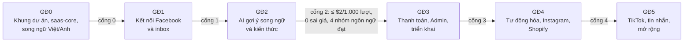

# 16 — Lộ trình phát triển

> Phiên bản 0.6 · 02/11/2026 (song ngữ Việt/Anh từ GĐ0; **không giới hạn thời gian** — các giai đoạn đi theo thứ tự và chỉ chuyển khi qua cổng kiểm tra) · Đồng bộ với [Kế hoạch xây dựng phần mềm — hướng B](https://claude.ai/artifact/JRWCLU1G8EWciSJchs1Fhw): tập trung phát triển phần mềm (cổng kiểm tra là cổng kỹ thuật), đa nền tảng Facebook → Instagram → TikTok, bổ sung đầy đủ chức năng theo giai đoạn (§3.2). Bản 0.3: **Thay đổi lớn:** dự án làm **mới từ đầu** (không có source sẵn). Repo Customer-Support-AI-Employee chỉ dùng làm **tài liệu tham khảo** (lấy ý tưởng, chuyển sang TypeScript), không làm nền. Thời lượng tính với 2–4 giờ/ngày. Phạm vi MVP rút gọn ở §3 là **đề xuất, cần chủ dự án xác nhận**.

## 1. Nguyên tắc

1. Dựng khung đúng kiến trúc ngay từ đầu (saas-core, RLS, hàng đợi, `ai_usage`) — sửa nền về sau đắt hơn nhiều.
2. Mỗi giai đoạn kết thúc bằng **cổng kiểm tra đo được**; chưa qua cổng thì không sang giai đoạn sau. **Không đặt hạn thời gian:** xong khi đạt chất lượng, không cắt chức năng để kịp ngày.
3. **Có bản chạy thật sớm nhất có thể:** ưu tiên luồng bình luận Facebook + gợi ý AI + nhân viên duyệt; AI tự gửi, Shopify, Instagram ở GĐ4; TikTok, tin nhắn ở GĐ5.
4. **Đa nền tảng từ thiết kế:** Facebook, Instagram, TikTok dùng chung pipeline, trang Bình luận, cơ sở kiến thức; mỗi nền tảng một connector theo interface chung (`12` §9) có từ GĐ1. Thứ tự theo mức sẵn sàng của API (§3.3).
5. **Pipeline AI tiết kiệm từ đầu:** lọc bằng quy tắc, cache, model nhỏ, ngữ cảnh ngắn; đo `ai_usage` từ lượt đầu tiên. Mục tiêu ≤ $2 / 1.000 lượt là cổng GĐ2.
6. **Chỉ cập nhật, không bỏ chức năng:** mọi chức năng trong `03`/`05` đều có giai đoạn ở §3.2; "làm sau" không có nghĩa là bỏ.
7. Mỗi việc: 1 nhánh, 1 kế hoạch (`docs/plans/`), quy trình `docs/workflows/`.

## 2. Tổng quan

Không có mốc ngày. Thứ tự và cổng kiểm tra là ràng buộc duy nhất; nhịp làm việc 2–4 giờ/ngày chỉ dùng để chia việc trong tuần.

## 3. Các giai đoạn

| GĐ | Bắt đầu khi | Việc chính | Cổng kiểm tra (xong khi) |
|---|---|---|---|
| **0 — Khung dự án & saas-core** | Ngay | **Dựng đủ 7 dịch vụ bằng Docker Compose** (web, worker, ml, LiteLLM, Langfuse tự host, Postgres + pgvector, Redis); chốt stack (ADR 001: trình quản lý gói, ORM/migration, thư viện auth, test; cân nhắc nextjs/saas-starter làm nền); monorepo theo `09` §3; Next.js; Postgres (Docker local) + RLS + `withWorkspace()`; `saas-core`: đăng ký/đăng nhập, quên mật khẩu, **2FA TOTP** (bắt buộc Owner/Admin) + mã dự phòng, giới hạn đăng nhập sai, workspace, thành viên Owner/Staff, lời mời, **bộ chuyển workspace**; bảng `feature_flags`, `ai_usage`, `action_logs`; pg-boss; CI (lint, typecheck, test, dependency-cruiser, gitleaks); design tokens từ `08` §2; **i18n Việt/Anh với next-intl (FR-119)**; `docs/codemap.md`; **song song:** bắt đầu **Business Verification** cho Meta App (app đang ở chế độ dev) — cần tên pháp lý/tên miền; Page thử + Instagram Business + Shopify dev store (đã có); đăng ký TikTok API for Business và xin quyền bình luận | Đăng ký → 2FA → tạo workspace → mời Staff → chuyển workspace chạy trên local, ở cả tiếng Việt và tiếng Anh; test RLS truy cập chéo xanh; CI xanh |
| **1 — Kết nối Facebook & inbox** | Qua cổng 0 | Interface connector chung (`12` §9) + connector Facebook; OAuth Meta, bảng `channels` (token mã hóa, `reply_language`), **trạng thái kênh + banner Kết nối lại**; webhook (xác minh chữ ký → job `ingest` → trả 200), chống trùng, polling bù + **cảnh báo webhook im lặng**, `skipOwnPage`, **lấy bình luận cũ khi kết nối** (số ngày = Q3); **bình luận bị sửa/xóa**; trang Bình luận (tab trạng thái, chi tiết, khóa mềm); trả lời/ẩn/bỏ ẩn **bằng tay**, gửi lỗi + Thử lại; trang Nhật ký | Bình luận thật trên Page thử nghiệm hiện trong inbox < 1 phút; trả lời và ẩn thành công; không trùng khi webhook gửi lại; token hết hạn → banner đúng |
| **2 — AI gợi ý & kiến thức** ⚠️ | Qua cổng 1 | Cơ sở kiến thức 8 phần (thông tin shop, sản phẩm có giá + thẻ sản phẩm, chính sách, FAQ, tài liệu, giọng văn theo ngôn ngữ, quy tắc trả lời, kiểm thử & phiên bản) + từ điển viết tắt; nhập tay + **Excel/CSV có khớp cột và xem lỗi**; bản nháp → xuất bản → khôi phục phiên bản; bộ câu kiểm thử; trang Bài viết gắn sản phẩm + ghi chú có hạn; pipeline: lọc quy tắc → chuẩn hóa + nhận vi/en + che PII → cache → phân loại (model nhỏ) → tìm kiến thức (toàn văn theo ngôn ngữ + sản phẩm gắn bài) → soạn → guard số tiền; lưu `price_snapshot`; gợi ý + chip nguồn; **lưu bản AI và bản gửi, ghi đổi nhãn**; ô Thử AI; **hành động hàng loạt, phím tắt, trang Bình luận trên mobile 390px**; `usage_counters` + đồng hồ lượt, cảnh báo 80%, chặn 100%; bộ đánh giá ~200 bình luận thật trong CI | **≤ $2 / 1.000 lượt** trên bộ đánh giá; mọi nhóm ngôn ngữ đạt `14` §4.2; **0 sai giá** |
| **3 — Thanh toán, Admin, triển khai** | Qua cổng 2 | Gói cước, dùng thử, mua thêm lượt, chuyển khoản QR, hóa đơn; Admin tối thiểu (Tổng quan, Workspaces, Thanh toán chờ xác nhận, Chi phí AI, trang Feature flags); endpoint xóa dữ liệu Meta + trang tra cứu; **xuất dữ liệu workspace, xóa workspace, thời gian lưu dữ liệu**; trang công khai (landing, chính sách quyền riêng tư, điều khoản, DPA); onboarding wizard 5 bước; triển khai VPS staging + production, **sao lưu hằng ngày + thử khôi phục, theo dõi lỗi và uptime**; chạy thử với Page thật (người dùng có vai trò trong Meta App dev; có thể 1–3 shop thử) | Chạy trên staging 7 ngày với bình luận thật; 0 sai giá; luồng thanh toán QR chạy trọn; endpoint xóa dữ liệu trả mã xác nhận; khôi phục sao lưu thành công |
| **4 — Tự động hóa, Instagram, Shopify** | Qua cổng 3 | Tự động hóa bình luận (Tắt / Chạy thử / Tự động theo kênh × nhãn, hiệu chuẩn, khoảng trễ, Dừng khẩn cấp, tự tạm dừng, lịch sử AI đã gửi + Đánh dấu sai, `sendRecheck` R1–R9); giới hạn tốc độ theo Page + job `abuse` + Admin tạm khóa gửi + trang Sức khỏe Meta App; quy tắc spam + mức Tự ẩn SĐT/link + **trang Khách tiềm năng** (Kanban, giao người, xuất Excel); **connector Instagram — bình luận** (cùng Meta App); nhập Shopify + đối soát hằng đêm; link chính sách; Admin: sức khỏe tích hợp, hàng đợi & dead letter; hồ sơ **App Review** (Facebook + Instagram) | Unit test 11 cổng + R1–R9 + test đua xanh; AI tự gửi an toàn trên Page thử (Chạy thử ≥ 50 mẫu, tỷ lệ sửa ≤ 10%); bình luận Instagram vào inbox và trả lời được; đối soát 7 đêm không lỗi; App Review đã nộp |
| **5 — TikTok, tin nhắn, mở rộng** | Qua cổng 4 (TikTok có thể sớm hơn khi được cấp quyền) | **Connector TikTok — bình luận** (khi đã được cấp quyền; có thể sớm hơn); Messenger + tin nhắn Instagram (24 giờ/7 ngày), trang Tin nhắn, nhắn riêng từ bình luận, tin chào/ngoài giờ/chuyển nhân viên; báo cáo + email tuần; thông báo đẩy (PWA) + email, giờ yên lặng; phần còn lại của Admin (gói & mã giảm giá, nội dung hệ thống, quản trị viên, Xem như khách); khi lượt AI tăng: dịch vụ `ml`, pgvector hybrid search, semantic cache, LiteLLM + Langfuse; Admin Console thêm tiếng Anh | Theo từng tính năng (`14` §8) |
### 3.1 Kiến trúc: **chốt 02/11 — dựng đủ 7 dịch vụ từ GĐ0**

Chủ dự án chọn dựng đủ `web`, `worker`, `ml`, `litellm`, `langfuse` (tự host cùng VPS), `postgres` + pgvector, `redis` ngay từ GĐ0. Lưu ý thực hiện:

- Bộ phân loại tự host (SetFit/linear) cần dữ liệu đã gán nhãn → giai đoạn đầu `classify` gọi LLM qua LiteLLM; dịch vụ `ml` chạy embedding, rerank, chuẩn hóa, nhận ngôn ngữ ngay; huấn luyện bộ phân loại khi đủ mẫu (cờ `cf.classify.ml`).
- Tìm kiếm kết hợp vector + toàn văn có từ GĐ2.
- VPS tại Việt Nam, 8 vCPU / 32 GB RAM (`15` §3).

Bảng dưới giữ lại để tham khảo phương án gọn đã cân nhắc (không áp dụng):

| Thành phần trong `09` | MVP làm gì thay | Đưa vào khi |
|---|---|---|
| Dịch vụ `ml` (bge-m3, reranker, SetFit) | Phân loại bằng model nhỏ + cache; tìm kiến thức bằng full-text `unaccent` + sản phẩm gắn bài | Kiến thức > vài trăm đoạn/workspace hoặc chi phí phân loại vượt ngưỡng (GĐ5) |
| pgvector + hybrid search | Full-text + ưu tiên ghi chú/sản phẩm gắn bài | Cùng lúc với `ml` |
| LiteLLM proxy | Lớp bọc mỏng trong `packages/ai`: ngân sách theo workspace, cache, ghi `ai_usage`, dự phòng 1 nhà cung cấp | Khi dùng ≥ 2 nhà cung cấp hoặc cần virtual key |
| Langfuse tự host | Bảng `ai_usage` + log có cấu trúc (hoặc Langfuse cloud gói miễn phí nếu cần trace) | GĐ5 hoặc khi debug prompt cần trace |
| Redis | pg-boss + khóa bằng Postgres (advisory lock); cache trong Postgres | Khi cần giới hạn tốc độ theo Page (GĐ4) hoặc cache nhiều |
| Shopify, URL crawl | Nhập tay + Excel | GĐ4 |

Lý do: giảm số dịch vụ phải vận hành từ 7 xuống 3 (`web`, `worker`, `postgres`) trong lúc chưa có khách; mỗi thành phần đẩy lùi đều có điểm cắm sẵn trong kiến trúc nên thêm sau không phải viết lại.

### 3.2 Chức năng theo giai đoạn (đủ mọi mã FR trong `05`)

Không chức năng nào bị bỏ; một số được tách thành phần MVP và phần làm sau.

| GĐ | Mã FR |
|---|---|
| 0 | FR-001, 002, 003, 004, 005, 119, 125; FR-034 (bảng + lớp bọc); FR-092 (bảng nhật ký); FR-117 (bảng flag); FR-118 |
| 1 | FR-123, FR-143 (lưu tệp đính kèm), FR-010, 011, 012, 016, 020, 021, 022, 023, 040, 041, 042, 044, 048; FR-092 (trang Nhật ký) |
| 2 | FR-121, FR-120 (gợi ý song ngữ, bộ đánh giá 4 nhóm), FR-127, 128, 129, 130, 131, 132, 133 (cột), 134, 135 (tìm kiếm chính xác), FR-136, 137, 138, 139, 140 (định tuyến, viết lại câu hỏi, prompt caching, halfvec, trích nguồn), FR-141 (gợi ý trả lời một phần), 142, 143 (quy tắc chuyển người), 144, 145, 146, FR-147 (thang xử lý), 148, 149, 150 (lệch giá quảng cáo), 151, 152, 153, 158, 159, 160, FR-161, 162, 163 (công thức), 164, 165, FR-024, 025, 026 (khớp chính xác), 027 (phân loại bằng model nhỏ), 028, 029, 030, 032, 033, 043, 045, 050, 051, 054, 056, 057 (toàn văn), 058, 059, 060, 061, 062, 063, 090 (hạn mức), 111 (lưu `price_snapshot`) |
| 3 | FR-126, FR-146 (bước onboarding), FR-150 (khách nhắc giá khác), FR-090 (gói, dùng thử, mua thêm), 091, 093, 094, 100, 101, 102, 103; FR-117 (trang Admin) |
| 4 | FR-122 (Shopify), FR-141 (tự gửi một phần), FR-147 (tự gửi câu hỏi lại/chuyển hướng), 154, 155, 156, 157, FR-163 (hiệu chuẩn độ tin cậy), FR-120 (tự gửi theo ngôn ngữ), FR-013 (bình luận Instagram), 031, 052, 053, 055 (lập chỉ mục nguồn đồng bộ, `content_hash`), 070, 071, 072, 073, 075, 080, 081, 082, 104 (sức khỏe tích hợp, hàng đợi & dead letter), 110, 112, 113, 114, 115, 116 |
| 5 | FR-122 (Haravan → Sapo → KiotViet → Pancake POS), FR-124, FR-133 (job tạo lại embedding), FR-143 (đọc ảnh, tùy chọn), FR-013 (tin nhắn Instagram), 014, 015 (TikTok), 046, 047, 074, 083, 084, 104 (phần còn lại), 105; FR-026 (semantic cache), 027 (bộ phân loại tự host), 055/057 (vector + hybrid) |
| 6 (mở rộng) | FR-166 (lên lịch và đăng bài tự động) |

### 3.3 Đa nền tảng: Facebook → Instagram → TikTok

| Nền tảng | Bình luận | Tin nhắn | Điều kiện | Mức đã xác minh | GĐ |
|---|---|---|---|---|---|
| Facebook | Đọc, trả lời, ẩn (Graph API) | Messenger 24 giờ / 7 ngày HUMAN_AGENT | App Review + Business Verification | Người dùng đã thử 01/11 | 1 (bình luận), 5 (tin nhắn) |
| Instagram | Đọc, trả lời, ẩn (Instagram Graph API, cùng Meta App) | 24 giờ | Tài khoản Business/Creator; `instagram_business_manage_comments` | Theo tài liệu; chưa thử thật | 4 (bình luận), 5 (tin nhắn) |
| TikTok | Đọc, trả lời trên video của tài khoản Business (TikTok API for Business, Organic/Accounts API); **ẩn chưa thấy API**; bình luận quảng cáo qua Ads Manager (API cần kiểm) | Business Messaging API | Tài khoản TikTok Business; đăng ký developer; khu vực Việt Nam chưa xác minh | **Chưa** | 5, sớm hơn nếu được cấp quyền |

Nếu TikTok không có API ẩn: quy tắc spam trên TikTok chỉ đánh dấu, nút Ẩn không hiện cho kênh TikTok (connector khai báo hành động được phép, FR-016). Chi tiết `12` §3.

### 3.4 Hướng mở rộng sau GĐ5 (ghi nhận 02/11)

| Hướng | FR | Ghi chú |
|---|---|---|
| Lên lịch và đăng bài tự động (Facebook, Instagram, sau đó TikTok) | FR-166 | Dùng lại connector (`capabilities.publish`), pg-boss (job hẹn giờ), thẻ sản phẩm và giọng văn; bài đăng từ app tự gắn sản phẩm → tăng độ chính xác trả lời bình luận. Xin quyền đăng bài ở đợt App Review riêng. Bắt đầu khi GĐ5 qua cổng |

## 4. Tham khảo từ Customer-Support-AI-Employee (MIT, commit `e125e7c`)

Không fork, không chạy repo này. Khi làm đến việc tương ứng, đọc file gốc để lấy ý tưởng, viết lại bằng TypeScript theo spec; nếu chép nguyên đoạn code thì giữ thông báo MIT.

| Ý tưởng | File gốc | Dùng ở |
|---|---|---|
| Thứ tự cổng tự gửi; code tính lại "cần duyệt" sau AI | `agent/graph.py` (`decide_auto_send`), `agent/response_engine.py` | GĐ4 |
| Đề xuất ngưỡng từ tỷ lệ bị sửa | `agent/automation.py` (`suggest_threshold`) | GĐ4 |
| Nội dung khách là dữ liệu, không phải lệnh; ca tấn công trong bộ đánh giá | `agent/classifier.py`, `evals/` | GĐ2 |
| Chỉ nạp ngữ cảnh khi nhãn cần | `graph.py` (`KB_RELEVANT_CATEGORIES`) | GĐ2 |
| Ghi mọi lần gọi AI theo bước | `agent/observability.py` | GĐ0–2 |
| Dead letter, circuit breaker | thư mục webhook/queue của repo | GĐ1 |

Không dùng: lưu trữ SQLite, xác thực bằng header store, Gorgias/Recharge/Skio, dashboard React của repo, regex số điện thoại kiểu Mỹ.

## 5. Ước tính chi phí AI (đo lại khi có `ai_usage` thật)

| Kịch bản | Trúng cache | Token soạn (vào chưa cache / cache / ra) | Phải gọi LLM phân loại | $ / 1.000 lượt | đ / 1.000 lượt |
|---|---|---|---|---|---|
| Xấu | 0% | 4.000 / 0 / 200 | 30% | 0,59 | 15.786 |
| Dự kiến | 20% | 1.800 / 1.200 / 150 | 15% | **0,25** | 6.700 |
| Tốt | 40% | 1.500 / 1.200 / 120 | 10% | 0,16 | 4.194 |

Giả định ban đầu tính với phân loại tự host. **Ở MVP (§3.1) phân loại dùng model nhỏ cho mọi lượt chưa trúng cache/quy tắc** → chi phí cao hơn bảng trên; vẫn phải đo và giữ ≤ $2. Giá model lấy qua nguồn thứ cấp — **đối chiếu bảng giá chính thức** trước khi chốt. Tỷ giá 27.000đ/USD.

Hạ tầng MVP: 1 VPS (web + worker + Postgres) — rẻ hơn nhiều so với kiến trúc đầy đủ; tra giá thật trước khi thuê.

## 6. Ngân sách

| Khoản | Ghi chú |
|---|---|
| Tổng thử nghiệm | 20 triệu VNĐ; tháng đầu tối đa 7 triệu |
| Claude Code (+ Codex khi cần) | Theo dõi hằng tuần trong `gap-matrix.md` |
| VPS | Chỉ thuê từ GĐ3 (trước đó chạy local) |
| LLM API | Trần theo workspace trong lớp bọc `packages/ai` |
| Pháp lý | Luật sư rà chính sách, DPA trước khi bán (GĐ3) |

## 7. Việc đầu tiên — Giai đoạn 0

- [ ] Cài Git, Node LTS, Claude Code; `git init` thư mục `CommentFlow`; chép bộ khởi động; commit đầu tiên.
- [ ] `claude` → kiểm `/model`, `/agents`, `/mcp` → `/stitch-sync` tải thiết kế.
- [ ] Plan mode: lập `docs/plans/chore-scaffold.md` + `docs/decisions/001-stack.md` (prompt trong `THIET_LAP.md` mục G). Duyệt.
- [ ] Dựng khung: monorepo, Next.js, Postgres Docker, `packages/db` (migration + RLS + `withWorkspace`), `packages/saas-core` (auth, tenancy), CI.
- [ ] `docs/codemap.md` từ khung vừa dựng; `docs/gap-matrix.md` = danh sách việc P0 theo thứ tự §3 (không cần `gap-analyzer`).
- [ ] Song song: tạo Meta App dev + Page thử nghiệm + tài khoản Instagram Business liên kết Page; đăng ký TikTok API for Business và xin quyền bình luận (thời gian duyệt chưa rõ, nộp sớm); gom ~200 bình luận thật (xóa thông tin cá nhân) cho bộ đánh giá GĐ2.

## 8. Quy trình hằng tuần

- **Tối ưu token:** đọc source ít lần nhất (`docs/codemap.md` + `docs/handoff/`), không làm trùng việc (một kế hoạch trong `docs/plans/`, một lần kiểm chứng cuối nhánh, kiểm tra máy móc giao cho công cụ), chỉ gọi AI thứ hai khi có giá trị kiểm chứng độc lập hoặc chuyên môn bổ sung. Làn Haiku cho việc cơ học kiểm được bằng công cụ.
- **Mỗi việc:** `/clear` → `/feature <mã>` → duyệt → code → `/finish` → commit. Hết token Claude → chuyển Codex theo `HUONG_DAN_CLAUDE_CODE.md` §7.
- **Cuối tuần (30 phút):** ghi chi phí / số mục xong / số lần gọi verifier vào `gap-matrix.md`; cắt/dời việc tuần sau.

## 9. Câu hỏi mở cần chốt

| # | Câu hỏi | Ảnh hưởng | Hạn chốt |
|---|---|---|---|
| Q0 | ~~Đồng ý phạm vi MVP rút gọn?~~ **Chốt 02/11: không rút gọn — dựng đủ 7 dịch vụ từ GĐ0** | Toàn bộ lộ trình | Đã chốt |
| Q1 | ~~Giao diện tiếng Anh có cần ngay không?~~ **Đã chốt 02/11: giao diện Việt + Anh từ GĐ0; AI tự trả lời tốt cả hai ngôn ngữ** | FR-119, FR-120 | Đã chốt |
| Q2 | Model phân loại/soạn sau đánh giá tiếng Việt? | Chi phí, chất lượng | Cuối GĐ2 |
| Q3 | ~~Lấy lại bao nhiêu ngày?~~ **Chốt: Owner chọn 3/7/30 ngày** | FR-011 | Đã chốt |
| Q4 | ~~Thời gian lưu dữ liệu?~~ **Chốt: 12 tháng** | FR-126 | Đã chốt |
| Q6 | Tên sản phẩm và tên miền | Trang chính sách, App Review, email (FR-125) | Trước khi nộp Business Verification/App Review |
| Q5 | TikTok cấp quyền API bình luận cho tài khoản Việt Nam không? Có API ẩn bình luận không? Giới hạn 48 giờ / 150 ký tự có đúng không? | Connector TikTok (GĐ5) | Khi có phản hồi đăng ký (bắt đầu GĐ0) |

## 10. Rủi ro tiến độ

| Rủi ro | Biện pháp |
|---|---|
| Làm từ đầu với 2–4 giờ/ngày | Không đặt hạn; đi theo thứ tự P0 → P1 → P2; mỗi giai đoạn có cổng rõ |
| Không đạt ≤ $2/1.000 lượt khi phân loại bằng LLM | Tăng quy tắc + cache; đưa dịch vụ `ml` lên sớm hơn |
| Meta App chưa qua App Review | Chạy thử bằng người dùng có vai trò trong app dev; nộp App Review ở GĐ4 |
| Chưa kiểm chứng nhu cầu | Chạy thử với Page thật ở GĐ3 (mục tiêu kinh doanh theo dõi riêng ở `02`) |
| TikTok chưa cấp quyền hoặc thiếu API ẩn | Đăng ký từ GĐ0; connector khai báo hành động được phép; Facebook/Instagram không phụ thuộc TikTok |
| GĐ1–2 nhiều việc hơn bản 0.3 | Không ép thời gian; chia nhỏ việc theo `docs/plans/`, đi theo thứ tự cổng |
